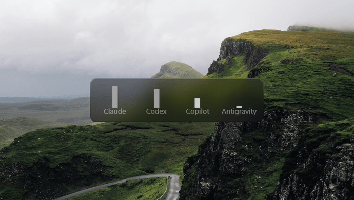
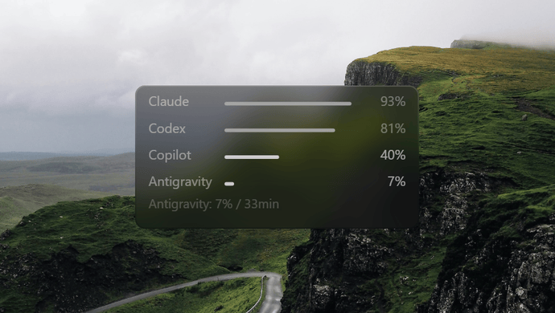
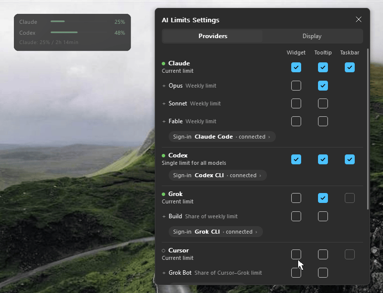
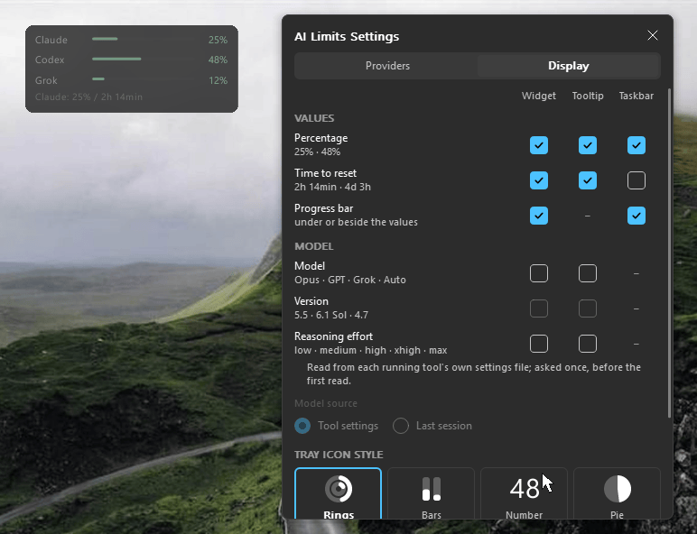

# AI Limits

<p align="center">
<a href="https://napxlexn.github.io/ailimits/"></a>
<a href="https://www.rust-lang.org/"></a>
<a href="https://github.com/napxlexn/ailimits/blob/master/LICENSE"></a>
<a href="https://github.com/napxlexn/ailimits/releases"></a>
<a href="https://github.com/napxlexn/ailimits/actions/workflows/ci.yml"></a>
<a href="https://github.com/napxlexn/ailimits/releases/latest"></a>
<a href="https://github.com/microsoft/winget-pkgs/tree/master/manifests/n/napxlexn/AILimits"></a>
<a href="https://community.chocolatey.org/packages/ailimits"></a>
<a href="https://github.com/napxlexn/scoop-ailimits"></a>
<a href="https://apps.microsoft.com/detail/9P2B0J1VWPWH"></a>
</p>

Una pequeña superposición flotante nativa para Windows 11 que muestra los límites
de uso de tus proveedores de IA directamente en el escritorio: **Claude**,
**OpenAI Codex**, **GitHub Copilot**, **Google Antigravity**, **xAI Grok**, **Cursor**.

<p align="center"><a href="https://napxlexn.github.io/ailimits/"></a></p>

<p align="center" class="languages"><a href="README.md">English</a> · <a href="README.uk.md">Українська</a> · <a href="README.zh-CN.md">简体中文</a> · <a href="README.ja.md">日本語</a> · <b>Español</b> · <a href="README.pt-BR.md">Português (Brasil)</a> · <a href="README.de.md">Deutsch</a> · <a href="README.fr.md">Français</a> · <a href="README.pl.md">Polski</a> · <a href="README.it.md">Italiano</a> · <a href="README.nl.md">Nederlands</a> · <a href="README.cs.md">Čeština</a></p>

Disponible en [Microsoft Store](https://apps.microsoft.com/detail/9P2B0J1VWPWH), firmada y actualizada por la tienda, y en [AlternativeTo](https://alternativeto.net/software/ai-limits/about/) — si te resulta útil, un "me gusta" allí ayuda a que otros la encuentren.

<p align="center">
<a href="https://apps.microsoft.com/detail/9P2B0J1VWPWH"></a>
</p>

<p align="center">
  
  <br><sub>Tres niveles de detalle: Compact, Medium, Expanded. El cambio se aplica en vivo; la previsión opcional del ritmo de consumo (~tiempo hasta el límite) aparece en la línea de metadatos cuando no se conoce la hora de restablecimiento. Aquí, con barras horizontales.</sub>
</p>

<p align="center">
  
  <br><sub>Con el widget oculto, el uso sigue a la vista en la barra de tareas. El icono de la bandeja muestra, como dos anillos, los mismos dos proveedores que el panel: los dos primeros del widget o los dos que elijas. Al pasar el puntero sobre el panel o el icono de la bandeja aparece la misma lista: las filas marcadas en la columna Tooltip. Ambos siguen el tema claro u oscuro del sistema.</sub>
</p>

<table>
<tr>
<td width="50%" align="center" valign="top">
  
  <br><sub>Los mismos tres niveles con barras verticales.</sub>
</td>
<td width="50%" align="center" valign="top">
  
  <br><sub>Tres pasos de ancho. En el más estrecho se omiten los nombres de los proveedores y la barra ocupa su columna, para que nada se superponga.</sub>
</td>
</tr>
<tr>
<td width="50%" align="center" valign="top">
  
  <br><sub>Opacidad del fondo, de casi transparente a casi opaco. El contraste del texto y de las barras no cambia.</sub>
</td>
<td width="50%" align="center" valign="top">
  
  <br><sub>La tarjeta se ajusta a las filas que muestras: una por cada proveedor que activaste, más las filas adicionales que elijas.</sub>
</td>
</tr>
<tr>
<td width="50%" align="center" valign="top">
  
  <br><sub>Monocromo y ocho paletas de color, con brillo, saturación y opacidad del fondo. Renderizado por la propia aplicación.</sub>
</td>
<td width="50%" align="center" valign="top">
  
  <br><sub>Con barras verticales, los proveedores se colocan uno al lado del otro o se apilan en una columna.</sub>
</td>
</tr>
<tr>
<td width="50%" align="center" valign="top">
  
  <br><sub><em>Settings</em>, Providers: una fila marcada aparece en el widget de inmediato; el Sign-in de cada proveedor indica qué se lee y adónde va su token.</sub>
</td>
<td width="50%" align="center" valign="top">
  
  <br><sub><em>Settings</em>, Display: qué muestra cada fila; sin la barra, el widget se hace más pequeño. Dibujado por la propia aplicación.</sub>
</td>
</tr>
</table>

## Qué hace

- **Lee, nunca escribe.** Lee los tokens que las herramientas CLI oficiales ya
  guardan en tu equipo. Nunca los renueva ni los rota, así que no puede cerrar
  tu sesión en esas herramientas. Cursor es la única excepción: la aplicación
  inicia sesión en él con una sesión propia y nunca lee ni toca el inicio de
  sesión del editor. Las claves que añades tú mismo, y esa sesión, se guardan
  en el Administrador de credenciales de Windows. La aplicación solo se
  conecta a los endpoints de los propios proveedores (y, en una copia
  instalada con el instalador, a GitHub para las actualizaciones), hace una
  solicitud de uso por proveedor y ciclo (más las pocas solicitudes auxiliares
  enumeradas en
  [docs/en/PROVIDERS.md](docs/en/PROVIDERS.md#requests-per-cycle) (en inglés)), usa
  el proxy configurado en Windows y no envía telemetría.
- **Pregunta antes de leer.** Nada que pertenezca a otra herramienta se lee
  hasta que lo permitas, y cada pregunta indica el archivo y adónde se envía
  su token. Cada permiso se pide una sola vez, y *Forget permission* lo retira
  con un clic. Consulta [Qué se lee y cuándo](docs/en/CONFIG.md#what-is-read-and-when) (en inglés).
- **Poca configuración.** En el primer inicio, las herramientas encontradas en
  este equipo ya aparecen marcadas, y una sola pregunta indica cada archivo de
  inicio de sesión que se leería: basta con *Allow*. Después, tu uso habitual
  de las CLI mantiene válidos sus tokens, así que no hay nada más que
  configurar. Solo Cursor te pide iniciar sesión una vez, en *Settings*.
- **Bajo consumo, medido con la aplicación en ejecución.** 0.014% de un núcleo
  de CPU, sin uso de GPU (renderiza en la CPU), un conjunto de trabajo de 53 MB
  (25 MB privados), medido para 0.7.1 el 2026-11-23; sin aumentar la resolución
  del temporizador (2026-11-21); un exe de 4 MB. Reprodúcelo con
  `bench/perf_audit.ps1`; las cifras completas están en
  [docs/en/ARCHITECTURE.md](docs/en/ARCHITECTURE.md#resource-footprint-measured-not-estimated) (en inglés).
- **Los datos desactualizados se marcan como tales.** Un valor que deja de
  actualizarse se vuelve gris y muestra su antigüedad. Una ventana de límite
  que se ha restablecido de forma comprobable muestra `≈0%`. La aplicación no
  rellena los huecos con suposiciones. El sondeo se pausa mientras estás
  ausente, y ese tiempo no cuenta: nada se vuelve gris solo porque te hayas
  alejado.
- **Autocontenida.** Enlazada estáticamente, así que no necesita Visual C++
  Redistributable ni incluye DLL adicionales. El instalador no requiere
  derechos de administrador.

## Instalación

> **¿Actualizas desde 0.7.0 (o 0.6.x) y la ruta de tu perfil de usuario o de
> tu carpeta TEMP contiene letras ajenas al alfabeto inglés (cirílicas, por
> ejemplo), `&` o `%`?** El actualizador de la versión anterior falla con una
> ruta así: cuando salga 0.7.1, puede cerrar AI Limits aproximadamente medio
> minuto después de cada inicio. Instala 0.7.1 a mano: descarga
> `AiLimits-Setup-0.7.1.exe` desde
> [Releases](https://github.com/napxlexn/ailimits/releases) y ejecútalo o,
> cuando winget ya ofrezca 0.7.1, ejecuta `winget upgrade napxlexn.AILimits`.
> Si el widget se cierra antes de que llegues a hacerlo, haz clic derecho sobre
> él justo después de un inicio y desmarca primero **Automatic updates** (o
> establece `auto_update = false` en `%APPDATA%\AiLimits\config.toml`). A
> partir de 0.7.1, el actualizador inicia el instalador directamente, esas
> rutas funcionan y puedes volver a marcar Automatic updates.

Desde la terminal:

```powershell
# winget
winget install napxlexn.AILimits

# one-line install: downloads the latest release, verifies its SHA-256
# against the published digest (the SHA-256 only, not the .sig), runs the
# silent per-user install (no admin rights)
irm https://raw.githubusercontent.com/napxlexn/ailimits/master/install.ps1 | iex

# Scoop, from the project's own bucket
scoop bucket add ailimits https://github.com/napxlexn/scoop-ailimits
scoop install ailimits

# Chocolatey
choco install ailimits

# Microsoft Store (signed and updated by the Store), or https://apps.microsoft.com/detail/9P2B0J1VWPWH
winget install --id 9P2B0J1VWPWH --source msstore
```

O consíguela en [Microsoft Store](https://apps.microsoft.com/detail/9P2B0J1VWPWH):
el mismo widget, firmado y mantenido al día por la tienda (puede ir unos días
por detrás de una versión mientras se certifica un paquete nuevo).

O descarga `AiLimits-Setup-<version>.exe` desde
[Releases](https://github.com/napxlexn/ailimits/releases) y ejecútalo.
No requiere derechos de administrador (se instala en `%LOCALAPPDATA%\AiLimits`).
Opcional durante la instalación: inicio automático con Windows (marcado de
forma predeterminada) y un acceso directo en el escritorio. winget y Chocolatey
ejecutan este mismo instalador, así que su copia se actualiza sola como
cualquier copia instalada con el instalador, y el gestor de paquetes puede
mostrar una versión anterior a la que está en ejecución.
Cada versión incluye también un zip portable (sin instalador). Una copia
portable no se actualiza sola: la actualiza su gestor de paquetes, o tú. No
hay modo portable para la configuración: todas las copias, incluida la
portable, la guardan en `%APPDATA%\AiLimits`.

> El instalador **no tiene firma de código** (Authenticode), por lo que Windows
> SmartScreen puede mostrar "Windows protegió su PC". Haz clic en **Más
> información → Ejecutar de todas formas**. Puedes verificar la descarga con el
> SHA-256 publicado en cada versión (ver más abajo). A partir de 0.7.1, cada
> versión incluye además una firma Ed25519 (`.sig`) para el instalador y el
> zip, y a partir de 0.7.1 el propio actualizador de la aplicación no instala
> nada sin una firma válida. El actualizador de 0.7.0 ignora el `.sig` y solo
> comprueba el SHA-256 que GitHub publica para el instalador: su actualización
> a 0.7.1 depende de ese hash.

Para comprobar una descarga a mano, compara su SHA-256 con el hash `sha256:`
que aparece junto al archivo en la página de la versión; ambos deben coincidir:

```powershell
(Get-FileHash .\AiLimits-Setup-0.7.1.exe -Algorithm SHA256).Hash
```

Para comprobar también la firma, coloca el `.sig` junto al archivo, ambos con
sus nombres publicados (la firma cubre el nombre). Después, en un clon de este
repositorio situado en la etiqueta de la versión (`git checkout v0.7.1`),
ejecuta el `verify` del firmador de versiones, que no necesita ninguna clave
(Rust, como en
[Compilar desde el código fuente](#compilar-desde-el-código-fuente)):

```powershell
cargo run --locked --release --manifest-path tools/release-signer/Cargo.toml -- verify $HOME\Downloads\AiLimits-Setup-0.7.1.exe
```

Imprime `verified`, o `NOT verified` con el motivo.

El instalador no contiene claves ni tokens. En el primer inicio, el widget no
lee ninguna de las fuentes de autenticación enumeradas más abajo hasta que lo
permitas.

### Desinstalación

Desinstalar desde Configuración de Windows, Aplicaciones, con
`winget uninstall napxlexn.AILimits` o con `choco uninstall ailimits` ejecuta
el desinstalador del instalador. Este cierra AI Limits y elimina, sin conexión:
su carpeta de instalación, `%APPDATA%\AiLimits` (configuración, caché,
registros), todas las entradas del Administrador de credenciales que creó la
aplicación (claves, tokens, la sesión de Cursor), el valor de inicio automático
y el registro de notificaciones.

Eliminar una copia de Scoop o portable no quita nada de eso:
`scoop uninstall ailimits`, o borrar la carpeta, solo elimina los archivos
propios de la aplicación. Antes de eliminarla, cierra AI Limits y ejecuta, en
su carpeta (un comando sin nada que eliminar no hace nada):

```
ailimits-auth remove claude
ailimits-auth remove copilot
ailimits-auth remove-usage-token claude
ailimits-auth remove-usage-token codex
ailimits-auth logout cursor
```

Después borra `%APPDATA%\AiLimits` y la clave del registro
`HKCU\Software\Classes\AppUserModelId\napxlexn.AILimits` (el nombre y el icono
que muestran las notificaciones de la aplicación). Para una copia de Microsoft
Store, cómo eliminar antes sus claves se explica en
[docs/en/CONFIG.md](docs/en/CONFIG.md#secrets) (en inglés); al desinstalarla se
elimina con ella su propia carpeta de configuración (la carpeta de la copia de
la tienda se describe al principio de ese archivo).

## Inicio rápido

1. **Ejecútalo.** En el primer inicio se abre una ventana de bienvenida (la
   misma que *Settings…* en el menú). Su pregunta enumera las herramientas
   encontradas en este equipo (Claude Code, Codex CLI, la Copilot CLI o
   GitHub CLI, Antigravity, la Grok CLI, Cursor), cada una con su casilla, e
   indica cada archivo que leería y adónde va cada token. Las herramientas
   detectadas por una carpeta propia aparecen marcadas; GitHub CLI por sí sola
   (para Copilot) o `.gemini` por sí sola (para Antigravity) aparece sin
   marcar. *Allow* activa las marcadas; *Cancel* no lee nada y te deja marcar
   lo que quieras, y cada herramienta pregunta una vez. La ventana no toma el
   foco del teclado (Enter no permite nada por accidente) y espera mientras
   haya una aplicación a pantalla completa delante. Como *Settings*, permanece
   abierta hasta que Esc, su cruz o Alt+F4 la cierran, y se mueve arrastrando
   su título. Cursor necesita un inicio de sesión propio de la aplicación, una
   sola vez: en la misma ventana, abre la línea *Sign-in* bajo Cursor y haz
   clic en *Sign in to Cursor…*.
   Actualizar desde 0.7.0 no requiere nada: los proveedores que tenías siguen
   funcionando y una ventana enumera lo que se lee.
2. **Colócalo.** Arrastra con el botón izquierdo. Mantén pulsado **Shift**
   mientras arrastras para pegarlo al borde más cercano del área de trabajo
   del monitor (la pantalla sin la barra de tareas) cuando esté a menos de
   64 px de ese borde.
   `Lock position` en el menú contextual lo fija.
3. **Ajusta el aspecto.** Haz clic derecho para elegir el nivel de detalle
   (Compact, Medium, Expanded), la disposición (Rows o Columns), la paleta
   (monocromática o de 8 colores), la opacidad, el brillo y la saturación. Las
   animaciones de arriba muestran cada opción.
   Al dejar el puntero sobre uno de estos elementos, o sobre Width, Column
   layout o Usage forecast, el resultado se ve en el widget, el panel y el
   icono de la bandeja antes de hacer clic, y lo mismo ocurre al llegar a él
   con el teclado; si sales del menú sin hacer clic, todo vuelve a como estaba.
   *Settings…*
   elige las filas que muestran el widget y el tooltip del panel (incluidas
   filas adicionales como la del límite semanal de Opus de Claude), una etiqueta opcional
   con el modelo en uso (modelo, versión, esfuerzo de razonamiento) y de dónde
   procede el inicio de sesión de cada proveedor. *Model source* elige de dónde
   sale el modelo de la etiqueta: *Tool settings*, o *Last session*, el modelo
   de la sesión más reciente de Claude Code o Codex CLI, leído del final de su
   archivo (como máximo el último 1 MB); las demás herramientas muestran el
   modelo tal como está configurado.
   La columna Taskbar elige los dos proveedores que muestran el panel y el
   icono de la bandeja; al menos uno queda siempre marcado. Percentage y Time
   to reset se marcan por separado para el tooltip del panel (columna Tooltip)
   y para el panel (columna Taskbar): el porcentaje, el tiempo hasta que se
   restablece el límite, o ambos; la última opción activa no se puede
   desmarcar. Progress bar (activado de forma predeterminada) permite quitar
   la barra del panel para que ocupe menos espacio en la barra de tareas.
4. **Pasa el puntero sobre una fila de proveedor** para ver su límite semanal
   en lugar de la cuenta regresiva de su restablecimiento (en Compact, en la
   línea inferior).
   Una fila en gris o con `≈` muestra en su lugar el motivo y la solución, por
   ejemplo `token expired — run Claude Code`. El motivo se muestra completo en
   las filas Medium y Expanded y en la línea inferior de Compact (con los
   anchos 100% y 75%), recortado para que quepa bajo una columna Expanded; las
   columnas Compact y Medium, y Compact al 50%, no lo muestran.
5. **¿El widget estorba?** Haz clic derecho, **Taskbar**, y luego *Taskbar panel*
   o *Tray icon*. Con el widget oculto o tapado por otras ventanas, el uso
   sigue a la vista en la barra de tareas; mientras una aplicación a pantalla
   completa ocupa la pantalla, se oculta con la barra de tareas y vuelve cuando
   sales de la aplicación. Consulta
   [Indicador en la barra de tareas](#indicador-en-la-barra-de-tareas).
6. **Haz clic izquierdo en el icono de la bandeja o en el panel** para traer
   el widget al frente u ocultarlo. Haz clic derecho en cualquiera de los dos
   para abrir el mismo menú.
7. **¿Un mensaje en lugar de filas?** *Setup required* o
   *No data yet*: haz clic en el widget para abrir *Settings*.
   *Right-click → set up providers*: hay proveedores marcados, pero ninguno
   tiene la sesión iniciada; revisa el *Sign-in* de cada proveedor en *Settings*.

## Cómo funciona la autorización

El widget nunca te pide iniciar sesión, salvo una vez para Cursor. Supervisa
los límites de la **suscripción** reutilizando los tokens que las herramientas
CLI oficiales guardan en tu equipo, en modo estrictamente de solo lectura y
solo después de que permitas cada uno:

| Proveedor | Fuente automática (predeterminada) | Para activarla |
|---|---|---|
| Claude | `%USERPROFILE%\.claude\.credentials.json` (token OAuth de Claude Code) | ejecuta [Claude Code](https://claude.com/claude-code) al menos una vez |
| Codex | `%USERPROFILE%\.codex\auth.json` (token de Codex CLI; en `CODEX_HOME` si está definido) | ejecuta `codex login` una vez |
| Copilot | `gh auth token --hostname github.com` (GitHub CLI) | `gh auth login` una vez |
| Antigravity | destino `gemini:antigravity` del Administrador de credenciales de Windows | ejecuta `agy`, la Antigravity CLI; su token dura aproximadamente una hora y solo `agy` lo renueva (abrir el editor no lo hace) |
| Grok | `%USERPROFILE%\.grok\auth.json` (inicio de sesión de Grok CLI; en `GROK_HOME` si está definido) | ejecuta `grok` e inicia sesión una vez (con una suscripción SuperGrok) |
| Cursor | la sesión propia del widget, en el Administrador de credenciales de Windows (`cursor_session`); para ello no se lee nada del editor Cursor | Inicia sesión en Cursor una vez en *Settings* (el *Sign-in* de Cursor, *Sign in to Cursor…*) o con `ailimits-auth login cursor`: la propia página de inicio de sesión de Cursor se abre en el navegador; sesión de ~60 días |

Bajo las filas de cada proveedor en la pestaña *Providers*, *Settings* tiene
una línea *Sign-in* que indica de dónde procede el inicio de sesión y cómo ha
ido ("Claude Code · connected"). Ábrela para elegir la fuente: la cuenta de la
herramienta indicada arriba (*Claude Code account*, etc.) o, para Claude,
Codex y Copilot, una clave o un token propios (consulta Autorización manual
más abajo). Solo se usa la fuente elegida; si falla, ninguna otra la
sustituye.

El permiso de cada herramienta se pide una sola vez. Desmarcar todas las filas
de un proveedor (Widget, Tooltip y Taskbar) lo pausa: no se lee ni se envía
nada suyo, y una marca lo reactiva sin preguntar. Para retirar el permiso,
abre su *Sign-in* y haz clic en *Forget permission* (visible mientras la
fuente sea el propio inicio de sesión de la herramienta): su inicio de sesión
deja de leerse, sus filas se desmarcan y la siguiente marca vuelve a preguntar.
La sesión de Cursor termina con *Sign out*; una clave o un token pegados se
eliminan con *Remove*. Las lecturas de la etiqueta del modelo tienen su propio
*Forget permission* en la pestaña *Display*, bajo Model, Version y Reasoning
effort. Los permisos se guardan por usuario de Windows, en el `config.toml` de
ese usuario.

Codex CLI solo escribe `auth.json` cuando guarda su inicio de sesión en un
archivo: con `cli_auth_credentials_store = "keyring"` o `"auto"` en su
`config.toml` no hay `auth.json`, y su inicio de sesión no se puede leer.
Establécelo en `"file"` o pega un token de uso en su lugar.

Son tokens de acceso OAuth, de corta duración salvo el de Cursor. La CLI a la
que pertenece cada uno lo renueva siempre que la usas. El widget nunca renueva
el token de otra aplicación, porque una renovación OAuth lo rota y cerraría la
sesión de la CLI. La sesión de Cursor (unos 60 días) pertenece al widget:
inicias sesión en Cursor en el navegador, en la propia página de Cursor, y el
widget guarda y renueva esa sesión por sí mismo. Cursor no ofrece inicio de
sesión para otras aplicaciones, así que el widget inicia sesión como el cliente
del editor Cursor; nunca lee el inicio de sesión del editor. `CODEX_HOME`,
`GROK_HOME` y `COPILOT_HOME` solo cuentan cuando son rutas absolutas.

### Cuánto tiempo se mantiene precisa sin hacer nada

| Proveedor | Los datos en vivo duran | Después |
|---|---|---|
| **Claude** | ~8 horas después de tu última sesión de Claude Code (la vida real del token) | muestra el último valor en gris, con su antigüedad |
| **Codex** | mientras uses Codex CLI (aún no se ha medido cuánto dura su token) | el último valor en gris, con su antigüedad |
| **Copilot** | Indefinidamente. gh mantiene su token vigente mientras sigas con la sesión iniciada. | |
| **Antigravity** | aproximadamente una hora después de la última ejecución de `agy` (solo `agy` renueva su token) | el último valor en gris, con su antigüedad |
| **Grok** | hasta ~6 horas después de tu última sesión de Grok CLI (la vida real del token) | el último valor en gris, con su antigüedad |
| **Cursor** | unos 60 días después de iniciar sesión (la vida de la sesión) | el último valor en gris, y `sign in to Cursor again` |

Google dejó de atender las solicitudes de Gemini CLI de los usuarios
individuales, de Google AI Pro y de Google AI Ultra el 18 de junio de 2026. Se
espera que esos usuarios migren a Antigravity CLI; el widget solo lee el token
de Antigravity en el Administrador de credenciales de Windows, y ya no el
archivo heredado de Gemini CLI. Google ha suspendido algunas cuentas por usar
el inicio de sesión de Antigravity fuera de Antigravity. El widget solo lee tu
cuota, una vez por actualización, pero el riesgo es tuyo: la pregunta que pide
leer el inicio de sesión de Antigravity lo advierte.

**Claude limita en el servidor la frecuencia con la que se puede leer.**
Anthropic limita la tasa del endpoint de uso (HTTP 429, `Retry-After: 0`,
verificado el 2026-07-09), y el presupuesto por token se comparte con el propio
sondeo de Claude Code. Mientras Claude Code está en ejecución, una
actualización de Claude puede tardar de 2 a 3 minutos incluso con el intervalo
de 1 minuto. El siguiente ciclo vuelve a consultar según el intervalo de
actualización; la espera solo crece (2, 4 y como máximo 5 minutos con el
intervalo de 1 minuto) cuando ningún proveedor trajo datos en un ciclo, y un
límite de tasa cuenta como ningún dato. Mientras tanto, al pasar el puntero
sobre la fila de Claude se lee `rate-limited, retrying`. Los demás proveedores
no se ven afectados.

Un token caducado de Claude, Codex, Antigravity, Grok o Cursor no produce cifras erróneas.
El último valor permanece en gris con su antigüedad, una ventana que se ha
restablecido de forma comprobable muestra `≈0%` y la cuenta regresiva del
restablecimiento sigue corriendo localmente. Si usas las CLI a diario, los
datos están en vivo casi todo el tiempo.

### Autorización manual (para mayor independencia o sin CLI)

Para configuraciones sin las CLI, o cuando quieres una credencial que no
dependa de la actividad de las CLI. Lo que ofrece realmente cada opción:

| Proveedor | Opción manual | Dónde obtenerla | ¿Muestra lo mismo que la suscripción? |
|---|---|---|---|
| **Copilot** | Un fine-grained Personal Access Token; no necesita ningún permiso (déjalos vacíos) | github.com/settings/personal-access-tokens, *Generate new token* | Verificado en vivo el 2026-11-21: un token sin permisos lee las mismas cuotas que el inicio de sesión de GitHub CLI. No necesita gh, hasta la fecha de caducidad que fijes. |
| **Claude** | Clave de API | console.anthropic.com, Settings, API Keys, *Create Key* (`sk-ant-…`) | No. Muestra los límites de tasa de tu cuenta de API, no el uso de tu suscripción Pro o Max. |
| **Codex** | Ninguna | No existe un token estable aparte. Un *Usage token* pegado es el mismo tipo de token OAuth que el de Codex CLI. | |
| **Antigravity** | Ninguna | La cuota está ligada al token OAuth que renueva Antigravity CLI, y ninguna clave aparte informa de las mismas cifras. | |
| **Grok** | Ninguna | El límite semanal de SuperGrok solo se lee con el inicio de sesión propio de Grok CLI. | |
| **Cursor** | Su propio inicio de sesión, unos 60 días | *Settings*, el *Sign-in* de Cursor, *Sign in to Cursor…*, o `ailimits-auth login cursor` | Sí. Es el uso propio de la suscripción. |

**Dos formas de añadir una credencial:**

1. **En *Settings*.** Copia la clave o el token. Abre la línea *Sign-in* del
   proveedor, elige la fuente (Claude: *Usage token* o *API key*; Codex:
   *Usage token*; Copilot: *Fine-grained token*) y haz clic en *Paste token
   from clipboard*
   (*Paste key from clipboard* para la clave de API de Claude). Solo se acepta
   ese tipo de secreto (`sk-ant-...`; `ghp_...`, `github_pat_...`, `gho_...`,
   `ghu_...` o un token hexadecimal clásico de 40 caracteres; un token de
   ChatGPT `eyJ...`): cualquier otra cosa que haya en el portapapeles se
   rechaza sin enviarse, y nunca se muestra ni se registra. Un token de uso se
   comprueba primero con una solicitud: si se rechaza, no se guarda. Una clave
   se guarda tal cual, y la fila indica si funciona. La ventana informa del
   resultado (con una notificación si la ventana se cerró mientras tanto), y
   el secreto va directamente al Administrador de credenciales. Solo se usa la
   fuente elegida: el inicio de sesión de la herramienta no se lee mientras
   esté elegido tu token o tu clave, y un token guardado no se envía mientras
   esté elegida la cuenta de la herramienta.
2. **Desde la terminal.** `ailimits-auth.exe` está junto al widget en
   `%LOCALAPPDATA%\AiLimits`:
   ```
   ailimits-auth status                       # show every detected source
   ailimits-auth set copilot                  # store a PAT (hidden input)
   ailimits-auth set claude                   # store a Claude API key
   ailimits-auth set-usage-token claude|codex # store a manual usage token
   ailimits-auth remove copilot|claude
   ailimits-auth remove-usage-token claude|codex
   ailimits-auth login cursor                 # sign in to Cursor in the browser
   ailimits-auth logout cursor                # forget that session
   ```
   `set-usage-token` comprueba el token con una solicitud al endpoint de uso
   del proveedor: uno rechazado (401/403) no se guarda; un límite de tasa (429)
   cuenta como aceptado; si no llega una respuesta concluyente en ningún
   sentido, vuelve a consultar tras 2 y 4 segundos y después lo guarda con una
   nota. `status` no cambia nada y solo lee el inicio de sesión de otra
   herramienta donde el widget puede hacerlo. Un widget en ejecución aplica por
   sí solo lo que cambian los demás comandos, sin reiniciar: un ajuste
   modificado en unos segundos, y una clave o un token nuevos o eliminados en
   su siguiente actualización. `set` y `set-usage-token` convierten lo que
   guardan en la fuente del proveedor.

**Para volver al inicio de sesión de la herramienta:** en el *Sign-in* del
proveedor, elige la cuenta de la herramienta (*Claude Code account*, *Codex CLI
account* o *GitHub CLI account*). Tu clave o tu token siguen guardados, pero
sin usarse; *Remove*, con su fuente elegida, los elimina. Desde la terminal,
`ailimits-auth remove claude|copilot` elimina la clave y vuelve a la cuenta de
la herramienta; `remove-usage-token` elimina el token pero mantiene la fuente
en él, así que la fila se oculta hasta que elijas la cuenta de la herramienta
en la ventana.

## El menú contextual

Haz clic derecho en el widget:

- `Settings…`: filas, etiquetas de modelo, alias de modelos, el inicio de
  sesión de cada proveedor.
- **Detail**: Compact / Medium / Expanded.
- **Layout**: Rows / Columns, y después Width (100 / 75 / 50%, en gris salvo
  con Rows) y Column layout (Side by side / Stacked, en gris salvo con Columns).
- **Appearance**: Palette (8 colores), Monochrome, Background opacity,
  Brightness, Saturation.
- **Taskbar**: Tray icon / Taskbar panel / None, y Panel display cuando
  hay más de una barra de tareas.
- `Always on top` y `Lock position` (dos opciones independientes), Usage
  forecast (previsión del ritmo de consumo, "~tiempo hasta el límite",
  desactivada de forma predeterminada).
- Refresh interval (1 / 5 / 15 / 30 min) y `Automatic updates` (actualización
  automática silenciosa en segundo plano de una copia instalada con el
  instalador, activada de forma predeterminada; las copias de Microsoft Store,
  de Scoop, portables y compiladas por uno mismo no tienen esta opción). Una
  versión nueva se anuncia una sola vez, en una notificación con *Install now*
  y *What's new*; si no haces nada, se instala sola la próxima vez que te
  ausentes durante cinco minutos.
- *AI Limits 0.7.1*, con el logotipo de GitHub (abre la página del proyecto),
  y Quit.

Usage forecast muestra su ~tiempo en las filas Medium y Expanded y en las
columnas Expanded, solo cuando no se conoce la hora de restablecimiento, y
nunca para datos que han dejado de actualizarse.

### Indicador en la barra de tareas

Con la superposición oculta o tapada por otras ventanas, una lectura compacta
del uso permanece en la barra de tareas; mientras una aplicación a pantalla
completa ocupa la pantalla, se oculta con la barra de tareas y vuelve cuando
sales de la aplicación. Clic derecho →
**Taskbar**:

- **Tray icon** (la opción predeterminada). Un único icono de 16px: dos anillos
  concéntricos para los mismos dos proveedores que muestra el panel (los dos
  primeros del widget, o los dos marcados en la columna Taskbar de
  *Settings*), el de mayor uso por fuera, ambos llenándose en el sentido de
  las agujas del reloj desde las 12. Monocromo, dibujado con el tema de la
  barra de tareas del sistema.
- **Taskbar panel.** Una superposición transparente junto al reloj. No hay
  ventana ni recuadro, solo dígitos del tamaño del reloj y barras dibujadas
  sobre la barra de tareas. Es monocromo, sigue el tema claro u oscuro del
  sistema, muestra los dos primeros proveedores en el orden del widget, o los
  dos marcados en la columna Taskbar de
  *Settings*, con su porcentaje (y su barra, salvo que Progress
  bar esté desmarcado allí), el tiempo hasta que se restablece su límite, o
  ambos (un valor que ha dejado de actualizarse, o una estimación con
  `≈`, se dibuja más tenue, igual que el widget lo pone en gris), y sigue a la
  barra de tareas cuando se mueve
  (ocultación automática, cambios de resolución, ancho de la bandeja). Pasa el
  puntero por encima para ver un tooltip con las filas marcadas en la columna
  Tooltip (todos los proveedores de forma predeterminada), cada una con su
  porcentaje y el momento en que se restablece.
  Si Inicio, Búsqueda o la barra oculta automáticamente lo tapan, cede su lugar
  a los anillos de la bandeja y vuelve por sí solo. Si una aplicación a
  pantalla completa ocupa la pantalla, se oculta con la barra de tareas y
  vuelve cuando sales con Alt+Tab. Funciona con la barra de tareas en
  cualquier borde de la pantalla: en una barra lateral, los dos proveedores se
  apilan, porcentaje sobre barra, encima de la bandeja. Una barra sin espacio
  libre entre su último botón de aplicación y la bandeja no recibe panel; los
  anillos de la bandeja lo sustituyen hasta que haya sitio, de modo que el
  panel nunca se coloca sobre los botones.
- **None.** Sin indicador.

Si Windows muestra la barra de tareas en más de una pantalla, **Taskbar → Panel display**
elige a qué barra de tareas se acopla el panel. El submenú solo aparece cuando
existe una segunda barra de tareas; si la pantalla elegida se desconecta más
tarde, el panel vuelve a la barra de tareas principal. El menú se crea al
iniciar la aplicación, así que una pantalla conectada después aparece en él
tras reiniciar. *Display 2*, *Display 3* y siguientes son las demás barras de
tareas contadas de izquierda a derecha, no los números de pantalla propios de
Windows.

Hacer clic izquierdo en el icono de la bandeja o en el panel trae el widget al
frente (o lo oculta si ya está allí, encima de todo); hacer clic derecho
**en cualquier parte del panel** abre este mismo menú.

## Configuración y diagnóstico

`%APPDATA%\AiLimits\config.toml` se crea automáticamente, y cada cambio en el
menú se guarda allí. Los cambios guardados en él se aplican mientras la
aplicación se ejecuta, en unos dos segundos, sin reiniciar; *Edit config.toml…*,
al final de la pestaña *Display* de *Settings*, lo abre en el Bloc de notas.
Una línea que no se puede leer se omite y se indica, y se usa su valor
predeterminado. El archivo se explica por sí mismo: una breve nota antes de
cada ajuste indica qué hace, los valores que admite y su valor predeterminado.
Referencia del formato: [docs/en/CONFIG.md](docs/en/CONFIG.md) (en inglés).
Ajustes finos más allá del menú (tamaños, colores, umbrales): [docs/en/TUNING.md](docs/en/TUNING.md) (en inglés).

Establece `AILIMITS_LOG=ailimits=debug` o `RUST_LOG=ailimits=debug` para
escribir un registro de diagnóstico en `%APPDATA%\AiLimits\ailimits.log`
(stderr no es visible en una aplicación con interfaz gráfica). El archivo rota
a los 5 MB: el anterior se conserva como `ailimits.log.1`.

Un fallo deja una línea en `%APPDATA%\AiLimits\crash.log` (hora, versión, hilo,
ubicación en el código fuente; nunca el texto del mensaje del fallo); un inicio
fallido lo indica en un mensaje y en ese archivo. Iniciar AI Limits de nuevo
mientras se ejecuta muestra el widget y lo trae al frente.

Una notificación de umbral aparece una vez por ventana de límite, cuando el uso
alcanza el `alert_threshold` del proveedor (80% de forma predeterminada, 85%
para Copilot); vuelve a aparecer solo después de que la ventana se restablezca,
o después de que el uso baje más de 5 puntos por debajo del umbral y vuelva a
subir. `[notifications]` en la configuración desactiva las notificaciones
(`enabled = false`) y fija el intervalo mínimo entre dos notificaciones de un
mismo proveedor (`cooldown_minutes`).

Las solicitudes usan el proxy configurado en Windows (Configuración, Red e
Internet, Proxy, "Usar un servidor proxy"); `HTTPS_PROXY`, `HTTP_PROXY` y
`ALL_PROXY` tienen prioridad, y no se sigue un script de proxy (PAC).
`ailimits-auth` solo sigue las variables, no el ajuste de Windows. Una red que
inspecciona TLS con su propio certificado raíz no se considera de confianza:
las filas muestran "untrusted certificate, retrying".

## Compilar desde el código fuente

Requiere Rust 1.90 o posterior con la cadena de herramientas MSVC: Visual
Studio Build Tools con la carga de trabajo de C++ y el Windows SDK, cuyo
`rc.exe` incrusta el icono, el manifiesto y la versión (consulta `build.rs`).
El instalador se compila con Inno Setup 6.7.4 a partir de los exe de
`release-min`. Una copia ejecutada desde `target\` no se actualiza sola y no
tiene la opción *Automatic updates*.

```
# Rust 1.90+ (MSVC), Windows 11
cargo build --profile release-min --locked   # ~4 MB exe in target/release-min/
cargo test --locked
ISCC.exe installer\ailimits.iss              # the installer, in target/installer/
```

Documentación para desarrolladores: [docs/en/](docs/en/) (en inglés).

## Licencia

Copyright (C) 2026 napxlexn.

AI Limits es software libre distribuido bajo la
[GNU General Public License, versión 3 o posterior](LICENSE). Puedes usarlo,
estudiarlo, modificarlo y redistribuirlo. Si distribuyes una versión
modificada, debes proporcionar su código fuente correspondiente bajo la misma
licencia, conservar los avisos de copyright y de licencia, y marcar claramente
tus cambios.

La licencia GPL del software no otorga derechos para presentar compilaciones
modificadas como versiones oficiales de AI Limits. Consulta
[TRADEMARKS.md](TRADEMARKS.md) para conocer las reglas que rigen el nombre y el
logotipo del proyecto. Los componentes de terceros siguen sujetos a sus
respectivas licencias; sus avisos se incluyen con cada copia en
[THIRD-PARTY-NOTICES.txt](THIRD-PARTY-NOTICES.txt).
