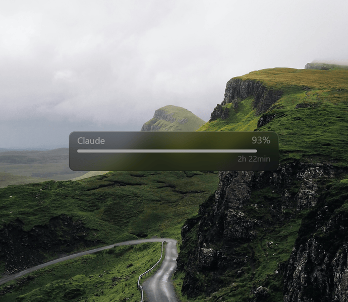

# AI Limits

<p align="center">
<a href="https://napxlexn.github.io/ailimits/"></a>
<a href="https://www.rust-lang.org/"></a>
<a href="https://github.com/napxlexn/ailimits/blob/master/LICENSE"></a>
<a href="https://github.com/napxlexn/ailimits/releases"></a>
<a href="https://github.com/napxlexn/ailimits/actions/workflows/ci.yml"></a>
<a href="https://github.com/napxlexn/ailimits/releases/latest"></a>
<a href="https://github.com/microsoft/winget-pkgs/tree/master/manifests/n/napxlexn/AILimits"></a>
<a href="https://community.chocolatey.org/packages/ailimits"></a>
<a href="https://github.com/napxlexn/scoop-ailimits"></a>
<a href="https://apps.microsoft.com/detail/9P2B0J1VWPWH"></a>
</p>

**Claude**、**OpenAI Codex**、**GitHub Copilot**、**Google Antigravity**、**xAI Grok**、**Cursor** の使用量の上限をデスクトップ上に直接表示する、Windows 11 向けの小さなネイティブ フローティング オーバーレイです。

<p align="center"><a href="https://napxlexn.github.io/ailimits/"></a></p>

<p align="center" class="languages"><a href="README.md">English</a> · <a href="README.uk.md">Українська</a> · <a href="README.zh-CN.md">简体中文</a> · <b>日本語</b> · <a href="README.es.md">Español</a> · <a href="README.pt-BR.md">Português (Brasil)</a> · <a href="README.de.md">Deutsch</a> · <a href="README.fr.md">Français</a> · <a href="README.pl.md">Polski</a> · <a href="README.it.md">Italiano</a> · <a href="README.nl.md">Nederlands</a> · <a href="README.cs.md">Čeština</a></p>

[Microsoft Store](https://apps.microsoft.com/detail/9P2B0J1VWPWH) で入手でき（署名と更新は Store が行います）、[AlternativeTo](https://alternativeto.net/software/ai-limits/about/) にも掲載されています。役に立ったら、そこで「いいね」を付けていただくと、ほかの人が見つけやすくなります。

<p align="center">
<a href="https://apps.microsoft.com/detail/9P2B0J1VWPWH"></a>
</p>

<p align="center">
  
  <br><sub>3 つの詳細レベル：Compact、Medium、Expanded。切り替えはすぐに反映されます。オプションの消費ペース予測（~上限到達までの時間）は、リセット時刻が不明な場合にメタ情報の行に表示されます。ここでは横向きのバーを使用しています。</sub>
</p>

<p align="center">
  
  <br><sub>ウィジェットを非表示にしても、使用量はタスクバーに表示されたままです。トレイアイコンは、パネルと同じ 2 つのプロバイダーを 2 つのリングで表示します。ウィジェットの先頭の 2 つか、選択した 2 つです。パネルまたはトレイアイコンにポインターを合わせると、同じ一覧（Tooltip 列でチェックした行）が表示されます。どちらもシステムのライト テーマとダーク テーマに従います。</sub>
</p>

<table>
<tr>
<td width="50%" align="center" valign="top">
  
  <br><sub>縦向きのバーでも同じ 3 つのレベルを使えます。</sub>
</td>
<td width="50%" align="center" valign="top">
  
  <br><sub>3 段階の幅。最も狭い幅ではプロバイダー名を省き、その列をバーが使うため、表示が重なることはありません。</sub>
</td>
</tr>
<tr>
<td width="50%" align="center" valign="top">
  
  <br><sub>背景の不透明度は、ほぼ透明からほぼ不透明まで。文字とバーのコントラストは変わりません。</sub>
</td>
<td width="50%" align="center" valign="top">
  
  <br><sub>カードの大きさは表示する行に合わせて決まります。有効にしたプロバイダーごとに 1 行、さらに選択した追加の行が加わります。</sub>
</td>
</tr>
<tr>
<td width="50%" align="center" valign="top">
  
  <br><sub>モノクロと 8 種類のカラー パレット。明るさ、彩度、背景の不透明度も調整できます。アプリ自身で描画しています。</sub>
</td>
<td width="50%" align="center" valign="top">
  
  <br><sub>縦向きのバーでは、プロバイダーを横に並べることも、1 列に積み重ねることもできます。</sub>
</td>
</tr>
<tr>
<td width="50%" align="center" valign="top">
  
  <br><sub><em>Settings</em>、Providers：チェックを入れた行はすぐにウィジェットに表示されます。各プロバイダーの Sign-in には、何を読み取り、トークンがどこへ送られるかが示されます。</sub>
</td>
<td width="50%" align="center" valign="top">
  
  <br><sub><em>Settings</em>、Display：各行に何を表示するかを設定します。バーを表示しないとウィジェットは小さくなります。アプリ自身で描画しています。</sub>
</td>
</tr>
</table>

## できること

- **読み取るだけで、書き込みません**。公式 CLI ツールがすでにこの PC に保存しているトークンを読み取ります。トークンを更新したりローテーションしたりすることはないため、それらのツールからログアウトさせてしまうことはありません。唯一の例外は Cursor で、アプリは独自のセッションで Cursor にサインインし、エディターのサインイン情報を読み取ったり変更したりすることはありません。自分で追加したキーとこのセッションは、Windows 資格情報マネージャーに保存されます。アプリが接続するのは各プロバイダー自身のエンドポイントだけで（インストーラー版では、更新のために GitHub にも接続します）、使用量のリクエストはプロバイダーごとに 1 サイクルにつき 1 回だけです（ほかに [docs/en/PROVIDERS.md](docs/en/PROVIDERS.md#requests-per-cycle)（英語）に記載したわずかな補助リクエストがあります）。Windows で設定したプロキシに従い、テレメトリは一切送信しません。
- **読み取る前に確認します**。許可するまで、ほかのツールに属するものは何も読み取りません。確認のたびに、対象のファイルとトークンの送信先を明示します。確認はそれぞれ 1 回だけで、*Forget permission* をクリックすれば 1 回で取り消せます。詳しくは [What is read, and when](docs/en/CONFIG.md#what-is-read-and-when)（英語）を参照してください。
- **セットアップはほとんど不要**。初回起動時には、この PC で見つかったツールにあらかじめチェックが入っており、読み取るすべてのサインイン ファイルを 1 つの確認で示します。*Allow* をクリックするだけで済みます。その後は普段どおり CLI を使っていればトークンは有効なまま保たれるので、ほかに設定することはありません。Cursor だけは、*Settings* で 1 回サインインする必要があります。
- **低負荷。実行中のアプリで計測**。CPU 1 コアの 0.014%、GPU は不使用（CPU で描画）、ワーキング セット 53 MB（プライベート 25 MB）。いずれも 0.7.1 で 2026-11-23 に計測したものです。タイマー分解能の引き上げなし（2026-11-21）。exe は 4 MB です。`bench/perf_audit.ps1` で再現でき、詳細な数値は [docs/en/ARCHITECTURE.md](docs/en/ARCHITECTURE.md#resource-footprint-measured-not-estimated)（英語）にあります。
- **古いデータは古いと明示します**。更新が止まった値はグレー表示になり、経過時間が表示されます。リセットされたことが確実な上限ウィンドウは `≈0%` と表示します。推測で空白を埋めることはしません。離席中はポーリングを一時停止し、その時間はカウントしないため、少し席を外しただけでグレー表示になることはありません。
- **単体で完結**。静的リンクのため、Visual C++ Redistributable も同梱 DLL も不要です。インストーラーに管理者権限は必要ありません。

## インストール

> **0.7.0（または 0.6.x）から更新する場合で、ユーザー プロファイルや TEMP フォルダーのパスに英語以外の文字（キリル文字など）、`&`、`%` が含まれていますか？** 旧バージョンのアップデーターはこのようなパスで失敗します。0.7.1 が公開されると、起動するたびに約 30 秒後に AI Limits が終了してしまう可能性があります。0.7.1 は手動でインストールしてください。[Releases](https://github.com/napxlexn/ailimits/releases) から `AiLimits-Setup-0.7.1.exe` をダウンロードして実行するか、winget で 0.7.1 が提供されるようになったら `winget upgrade napxlexn.AILimits` を実行します。操作する前にウィジェットが終了してしまう場合は、起動直後にウィジェットを右クリックし、まず **Automatic updates** のチェックを外してください（または `%APPDATA%\AiLimits\config.toml` で `auto_update = false` を設定します）。0.7.1 以降はアップデーターがインストーラーを直接起動するため、このようなパスでも動作し、Automatic updates に再びチェックを入れても問題ありません。

ターミナルから：

```powershell
# winget
winget install napxlexn.AILimits

# one-line install: downloads the latest release, verifies its SHA-256
# against the published digest (the SHA-256 only, not the .sig), runs the
# silent per-user install (no admin rights)
irm https://raw.githubusercontent.com/napxlexn/ailimits/master/install.ps1 | iex

# Scoop, from the project's own bucket
scoop bucket add ailimits https://github.com/napxlexn/scoop-ailimits
scoop install ailimits

# Chocolatey
choco install ailimits

# Microsoft Store (signed and updated by the Store), or https://apps.microsoft.com/detail/9P2B0J1VWPWH
winget install --id 9P2B0J1VWPWH --source msstore
```

または [Microsoft Store](https://apps.microsoft.com/detail/9P2B0J1VWPWH) から入手することもできます。中身は同じウィジェットで、署名と最新版への更新は Store が行います（新しいパッケージの認定中は、リリースから数日遅れることがあります）。

または [Releases](https://github.com/napxlexn/ailimits/releases) から `AiLimits-Setup-<version>.exe` をダウンロードして実行します。管理者権限は不要です（`%LOCALAPPDATA%\AiLimits` にインストールされます）。セットアップ中に選べるオプション：Windows と同時に自動起動（既定でオン）、デスクトップ ショートカット。winget と Chocolatey はこれと同じインストーラーを実行するため、そのコピーもほかのインストーラー版と同様に自動で更新され、パッケージ マネージャーに表示されるバージョンが実行中のものより古いことがあります。各リリースにはポータブル版の zip（インストーラーなし）も添付されています。ポータブル版は自動更新されません。パッケージ マネージャーか、ご自身で更新してください。設定にはポータブル モードがありません。ポータブル版を含むすべてのコピーが `%APPDATA%\AiLimits` に設定を保存します。

> インストーラーは**コード署名されていない**（Authenticode）ため、Windows SmartScreen が「Windows によって PC が保護されました」と表示することがあります。**詳細情報 → 実行** をクリックしてください。ダウンロードしたファイルは、各リリースで公開している SHA-256 と照合できます（下記参照）。0.7.1 以降、各リリースにはインストーラーと zip の Ed25519 署名（`.sig`）も付属し、0.7.1 以降のアプリ自身のアップデーターは、有効な署名がなければ何もインストールしません。0.7.0 のアップデーターは `.sig` を無視し、GitHub がインストーラーについて公開している SHA-256 だけを確認します。0.7.1 への更新は、このダイジェストに依存しています。

ダウンロードしたファイルを手動で確認するには、その SHA-256 を、リリース ページでファイルの横に表示されている `sha256:` ダイジェストと比較します。両者が一致している必要があります：

```powershell
(Get-FileHash .\AiLimits-Setup-0.7.1.exe -Algorithm SHA256).Hash
```

署名も確認するには、`.sig` をファイルと同じ場所に置き、どちらも公開時のファイル名のままにします（署名はファイル名も対象にしています）。次に、このリポジトリのクローンをリリース タグに切り替えた状態で（`git checkout v0.7.1`）、リリース署名ツールの `verify` を実行します。キーは不要です（Rust が必要です。[ソースからのビルド](#ソースからのビルド) を参照）：

```powershell
cargo run --locked --release --manifest-path tools/release-signer/Cargo.toml -- verify $HOME\Downloads\AiLimits-Setup-0.7.1.exe
```

`verified` と表示されるか、`NOT verified` と理由が表示されます。

インストーラーにはキーもトークンも含まれていません。初回起動時、ウィジェットは許可されるまで、以下に挙げる認証情報の取得元をいずれも読み取りません。

### アンインストール

Windows の設定の「アプリ」からアンインストールするか、`winget uninstall napxlexn.AILimits` または `choco uninstall ailimits` を使うと、インストーラーのアンインストーラーが実行されます。アンインストーラーは AI Limits を終了し、オフラインで次のものを削除します：インストール フォルダー、`%APPDATA%\AiLimits`（設定、キャッシュ、ログ）、アプリが作成したすべての資格情報マネージャーのエントリ（キー、トークン、Cursor のセッション）、自動起動の値、通知の登録。

Scoop 版やポータブル版を削除しても、これらはいずれも削除されません。`scoop uninstall ailimits` やフォルダーの削除で消えるのは、アプリ自身のファイルだけです。削除する前に AI Limits を終了し、そのフォルダーで次のコマンドを実行してください（削除するものがないコマンドは何もしません）：

```
ailimits-auth remove claude
ailimits-auth remove copilot
ailimits-auth remove-usage-token claude
ailimits-auth remove-usage-token codex
ailimits-auth logout cursor
```

その後、`%APPDATA%\AiLimits` とレジストリ キー `HKCU\Software\Classes\AppUserModelId\napxlexn.AILimits`（アプリのトースト通知に表示される名前とアイコン）を削除します。Microsoft Store 版の場合：先にキーを削除する方法は [docs/en/CONFIG.md](docs/en/CONFIG.md#secrets)（英語）にあります。Store 版を削除すると、その設定フォルダーも一緒に削除されます（Store 版のフォルダーについては、同ファイルの冒頭で説明しています）。

## クイックスタート

1. **起動する**。初回起動時にはウェルカム ウィンドウが開きます（メニューの *Settings…* と同じウィンドウです）。その確認には、この PC で見つかったツール（Claude Code、Codex CLI、Copilot CLI または GitHub CLI、Antigravity、Grok CLI、Cursor）がそれぞれチェックボックス付きで一覧表示され、読み取るすべてのファイルと、各トークンの送信先が示されます。専用のフォルダーで見つかったツールには最初からチェックが入っています。GitHub CLI だけ（Copilot 用）や `.gemini` だけ（Antigravity 用）が見つかった場合は、チェックなしで表示されます。*Allow* を押すとチェックしたツールが開始されます。*Cancel* を押すと何も読み取らず、必要なものに後からチェックを入れられます（ツールごとに 1 回ずつ確認されます）。このウィンドウはキーボード フォーカスを取らず（Enter キーで誤って許可することはありません）、全画面アプリが前面にある間は待機します。*Settings* と同様に、Esc キー、閉じるボタン、Alt+F4 のいずれかで閉じるまで開いたままで、タイトル部分をドラッグして移動できます。Cursor には、アプリ独自のサインインが 1 回必要です。同じウィンドウで Cursor の下にある *Sign-in* 行を開き、*Sign in to Cursor…* をクリックします。0.7.0 からの更新では何もする必要はありません。それまで使っていたプロバイダーはそのまま動作し、読み取る内容を 1 つのウィンドウで一覧表示します。
2. **配置する**。左ボタンでドラッグします。ドラッグ中に **Shift** を押し続けると、モニターの作業領域（タスクバーを除いた画面）の最も近い端から 64 px 以内に入ったときに、その端にぴったり寄せられます。右クリック メニューの `Lock position` で位置を固定できます。
3. **見た目を設定する**。右クリックすると、詳細レベル（Compact、Medium、Expanded）、レイアウト（Rows または Columns）、パレット（モノクロまたは 8 色）、不透明度、明るさ、彩度を設定できます。上のアニメーションでそれぞれを紹介しています。これらの項目、または Width、Column layout、Usage forecast にポインターを置くと、クリックする前にウィジェット、パネル、トレイアイコンにその設定がプレビューされます。キーボードで項目に移動した場合も同じです。クリックせずにメニューを離れると元に戻ります。*Settings…* では、ウィジェットとパネルのツールチップに表示する行（Claude の Opus 週間上限などの追加の行を含む）、使用中のモデルを示すオプションのラベル（モデル、バージョン、推論の強度）、各プロバイダーのサインイン情報の取得元を選びます。*Model source* では、ラベルに表示するモデルの取得元を選びます。*Tool settings* か *Last session* のどちらかで、後者は最新の Claude Code または Codex CLI セッションのモデルを、そのファイルの末尾から読み取ります（読み取るのは最後の最大 1 MB）。ほかのツールでは、設定されているモデルが表示されます。Taskbar 列では、パネルとトレイアイコンに表示する 2 つのプロバイダーを選びます。少なくとも 1 つはチェックが入ったままになります。Percentage と Time to reset は、パネルのツールチップ（Tooltip 列）とパネル（Taskbar 列）で個別にチェックします。表示されるのはパーセンテージ、上限がリセットされるまでの時間、またはその両方です。最後に残ったオンの項目はチェックを外せません。Progress bar（既定でオン）のチェックを外すと、パネルのバーが省かれ、タスクバーで占める幅が小さくなります。
4. **プロバイダーの行にポインターを合わせる**と、リセットまでのカウントダウンの代わりに週間上限が表示されます（Compact では最下行に表示）。グレー表示の行や `≈` の付いた行では、代わりに理由と対処法が表示されます。例：`token expired — run Claude Code`。理由は、Medium と Expanded の行、および Compact の最下行（幅 100% と 75% のとき）では全文が表示され、Expanded の列では列の下に収まるよう切り詰めて表示されます。Compact と Medium の列、および幅 50% の Compact では表示されません。
5. **ウィジェットが邪魔なとき**は、右クリックして **Taskbar** を選び、*Taskbar panel* または *Tray icon* を選びます。ウィジェットが非表示のときや、ほかのウィンドウに隠れているときも、使用量はタスクバーに表示されたままです。全画面アプリが画面を占有している間はタスクバーと一緒に非表示になり、そのアプリを離れると再び表示されます。[タスクバーインジケーター](#タスクバーインジケーター) を参照してください。
6. **トレイアイコンまたはパネルを左クリック**すると、ウィジェットを前面に表示したり、非表示にしたりできます。どちらを右クリックしても同じメニューが開きます。
7. **行の代わりにメッセージが表示される場合**：*Setup required* または *No data yet* の場合は、ウィジェットをクリックして *Settings* を開きます。*Right-click → set up providers* の場合は、プロバイダーにチェックは入っているものの、どれもサインインしていません。*Settings* で各プロバイダーの *Sign-in* を確認してください。

## 認証のしくみ

ウィジェットがログインを求めることはありません（Cursor で 1 回だけ必要な場合を除きます）。公式 CLI ツールがこの PC に保存しているトークンを再利用して**サブスクリプション**の上限を監視します。厳密に読み取り専用で、それぞれを許可した後にのみ読み取ります：

| プロバイダー | 自動の取得元（既定） | 有効にする方法 |
|---|---|---|
| Claude | `%USERPROFILE%\.claude\.credentials.json`（Claude Code の OAuth トークン） | [Claude Code](https://claude.com/claude-code) を 1 回以上実行する |
| Codex | `%USERPROFILE%\.codex\auth.json`（Codex CLI のトークン。`CODEX_HOME` が設定されている場合はその中） | `codex login` を 1 回実行する |
| Copilot | `gh auth token --hostname github.com`（GitHub CLI） | `gh auth login` を 1 回実行する |
| Antigravity | Windows 資格情報マネージャーのターゲット `gemini:antigravity` | Antigravity CLI の `agy` を実行する。トークンの有効期間は約 1 時間で、更新するのは `agy` だけ（エディターを開いても更新されない） |
| Grok | `%USERPROFILE%\.grok\auth.json`（Grok CLI のログイン情報。`GROK_HOME` が設定されている場合はその中） | `grok` を実行して 1 回サインインする（SuperGrok サブスクリプション） |
| Cursor | ウィジェット独自のセッション。Windows 資格情報マネージャー（`cursor_session`）に保存。そのために Cursor エディターのものは何も読み取らない | *Settings* で Cursor に 1 回サインインする（Cursor の *Sign-in*、*Sign in to Cursor…*）か、`ailimits-auth login cursor` を使う。ブラウザーで Cursor 自身のサインイン ページが開く。セッションは約 60 日 |

*Settings* の *Providers* タブでは、各プロバイダーの行の下に *Sign-in* 行があり、サインイン情報の取得元と状態（「Claude Code · connected」）が表示されます。これを開いて取得元を選びます。上の表にあるツールのアカウント（*Claude Code account* など）か、Claude、Codex、Copilot では自分のキーまたはトークン（後述の「手動認証」を参照）です。使われるのは選択した取得元だけで、それが失敗しても別の取得元で代用されることはありません。

確認はツールごとに 1 回だけです。プロバイダーの行（Widget、Tooltip、Taskbar）のチェックをすべて外すと、そのプロバイダーは一時停止します。そのプロバイダーについては何も読み取らず、何も送信しません。再びチェックを入れれば、確認なしで再開します。許可を取り消すには、その *Sign-in* を開いて *Forget permission* をクリックします（ツール自身のサインイン情報が取得元のときに表示されます）。以後そのサインイン情報は読み取られず、行のチェックは外れ、次にチェックを入れたときに再び確認されます。Cursor のセッションは *Sign out* で終了し、貼り付けたキーやトークンは *Remove* で削除します。モデル ラベルの読み取りには、*Display* タブの Model、Version、Reasoning effort の下に専用の *Forget permission* があります。許可は Windows ユーザーごとに、そのユーザーの `config.toml` に保存されます。

Codex CLI が `auth.json` を書き込むのは、サインイン情報をファイルに保存する場合だけです。Codex CLI の `config.toml` で `cli_auth_credentials_store = "keyring"` または `"auto"` が指定されていると `auth.json` は作成されず、サインイン情報を読み取れません。`"file"` に設定するか、代わりに使用量トークンを貼り付けてください。

これらは OAuth アクセス トークンで、Cursor のもの以外は有効期間が短いものです。各トークンを所有する CLI は、使うたびにトークンを更新します。ウィジェットがほかのアプリのトークンを更新することはありません。OAuth の更新はトークンをローテーションするため、その CLI がログアウトしてしまうからです。Cursor のセッション（約 60 日）はウィジェット自身のものです。ブラウザーで Cursor 自身のページから Cursor にサインインし、そのセッションはウィジェットが自分で保持して更新します。Cursor にはほかのアプリ向けのサインイン手段がないため、ウィジェットは Cursor エディターのクライアントとしてサインインします。エディターのサインイン情報を読み取ることはありません。`CODEX_HOME`、`GROK_HOME`、`COPILOT_HOME` は、絶対パスの場合にのみ有効です。

### 操作しなくても正確さが保たれる期間

| プロバイダー | ライブ データが保たれる期間 | その後 |
|---|---|---|
| **Claude** | 最後の Claude Code セッションから約 8 時間（トークンの実際の有効期間） | 最後の値をグレー表示し、経過時間を表示 |
| **Codex** | Codex CLI を使っている間（トークンの有効期間はまだ計測していない） | 最後の値をグレー表示し、経過時間を表示 |
| **Copilot** | 無期限。ログインしている限り、gh がトークンを新しい状態に保ちます。 | |
| **Antigravity** | 最後に `agy` を実行してから約 1 時間（トークンを更新するのは `agy` だけ） | 最後の値をグレー表示し、経過時間を表示 |
| **Grok** | 最後の Grok CLI セッションから最大で約 6 時間（トークンの実際の有効期間） | 最後の値をグレー表示し、経過時間を表示 |
| **Cursor** | サインインから約 60 日（セッションの有効期間） | 最後の値をグレー表示し、`sign in to Cursor again` を表示 |

Google は 2026 年 6 月 18 日に、個人ユーザーと Google AI Pro、Google AI Ultra のユーザーに対する Gemini CLI リクエストの処理を停止しました。これらのユーザーは Antigravity CLI に移行することが想定されています。ウィジェットが読み取るのは Antigravity の Windows 資格情報マネージャーのトークンだけで、従来の Gemini CLI のファイルはもう読み取りません。Google は、Antigravity 以外で Antigravity のサインイン情報を使用したとして、一部のアカウントを停止しています。ウィジェットは更新のたびに 1 回クォータを読み取るだけですが、リスクはご自身で負うことになります。Antigravity のサインイン情報の読み取りを求める確認にも、その旨が記載されています。

**Claude には、読み取り頻度に関するサーバー側の制限があります**。Anthropic は使用量エンドポイントにレート制限をかけており（HTTP 429、`Retry-After: 0`、2026-07-09 に確認）、トークンごとの割り当ては Claude Code 自身のポーリングと共有されます。Claude Code の実行中は、更新間隔が 1 分でも、Claude の更新に 2～3 分かかることがあります。次のサイクルは更新間隔どおりに再度リクエストします。待ち時間が延びる（1 分間隔の場合、2 分、4 分、その後は最大 5 分）のは、あるサイクルでどのプロバイダーからもデータが得られなかった場合だけで、レート制限はデータなしとして扱われます。その間、Claude の行にポインターを合わせると `rate-limited, retrying` と表示されます。ほかのプロバイダーには影響しません。

Claude、Codex、Antigravity、Grok、Cursor のトークンが期限切れになっても、誤った数値が表示されることはありません。最後の値は経過時間とともにグレー表示のまま残り、リセットされたことが確実なウィンドウは `≈0%` と表示され、リセットまでのカウントダウンはローカルで進み続けます。CLI を毎日使っていれば、データはほぼ常にライブです。

### 手動認証（CLI に依存しない場合や CLI がない環境向け）

CLI がない環境向け、または CLI の利用状況に左右されない資格情報を使いたい場合の方法です。各方法で実際に得られるもの：

| プロバイダー | 手動の方法 | 入手先 | サブスクリプションと同じ内容が表示されるか |
|---|---|---|---|
| **Copilot** | Fine-grained の個人用アクセス トークン。権限は一切不要（空のままにする） | github.com/settings/personal-access-tokens、*Generate new token* | 2026-11-21 に実際に確認済み：権限なしのトークンでも、GitHub CLI のサインインと同じクォータを読み取れます。設定した有効期限までは gh も不要です。 |
| **Claude** | API キー | console.anthropic.com、Settings、API Keys、*Create Key*（`sk-ant-…`） | いいえ。表示されるのは API アカウントのレート制限で、Pro や Max のサブスクリプションの使用量ではありません。 |
| **Codex** | なし | 別個の安定したトークンは存在しません。貼り付けた *Usage token* は、Codex CLI のものと同じ種類の OAuth トークンです。 | |
| **Antigravity** | なし | クォータは Antigravity CLI が更新する OAuth トークンに結び付いており、同じ数値を返す別のキーはありません。 | |
| **Grok** | なし | SuperGrok の週間上限は、Grok CLI 自身のログイン情報でのみ読み取れます。 | |
| **Cursor** | 独自のサインイン（約 60 日） | *Settings*、Cursor の *Sign-in*、*Sign in to Cursor…*、または `ailimits-auth login cursor` | はい。サブスクリプションそのものの使用量です。 |

**資格情報を追加する 2 つの方法：**

1. ***Settings* で追加する**。キーまたはトークンをコピーします。プロバイダーの *Sign-in* 行を開いて取得元を選び（Claude：*Usage token* または *API key*、Codex：*Usage token*、Copilot：*Fine-grained token*）、*Paste token from clipboard* をクリックします（Claude の API キーの場合は *Paste key from clipboard*）。受け付けるのはその種類のシークレットだけです（`sk-ant-...` / `ghp_...`、`github_pat_...`、`gho_...`、`ghu_...`、または従来型の 40 文字の 16 進トークン / ChatGPT のトークン `eyJ...`）。クリップボードにあるそれ以外のものは送信されずに拒否され、表示されることもログに記録されることもありません。使用量トークンは、まず 1 回のリクエストで確認され、拒否されたものは保存されません。キーはそのまま保存され、有効かどうかは行に表示されます。結果はウィンドウに表示され（その間にウィンドウを閉じた場合はトースト通知で知らせます）、シークレットは直接資格情報マネージャーに保存されます。使われるのは選択した取得元だけです。自分のトークンやキーを選んでいる間はツールのサインイン情報は読み取られず、ツールのアカウントを選んでいる間は保存済みのトークンは送信されません。
2. **ターミナルから**。`ailimits-auth.exe` は、ウィジェットと同じ `%LOCALAPPDATA%\AiLimits` にあります：
   ```
   ailimits-auth status                       # show every detected source
   ailimits-auth set copilot                  # store a PAT (hidden input)
   ailimits-auth set claude                   # store a Claude API key
   ailimits-auth set-usage-token claude|codex # store a manual usage token
   ailimits-auth remove copilot|claude
   ailimits-auth remove-usage-token claude|codex
   ailimits-auth login cursor                 # sign in to Cursor in the browser
   ailimits-auth logout cursor                # forget that session
   ```
   `set-usage-token` は、プロバイダーの使用量エンドポイントに 1 回リクエストを送ってトークンを確認します。拒否されたもの（401/403）は保存されません。レート制限（429）は受け付けたものとして扱います。どちらとも判断できる応答がない場合は、2 秒後と 4 秒後に再度確認し、その後は注記を付けて保存します。`status` は何も変更せず、ほかのツールのサインイン情報は、ウィジェットに読み取りが許可されている場合にのみ読み取ります。実行中のウィジェットは、ほかのコマンドによる変更を再起動なしで自動的に反映します。設定の変更は数秒以内に、キーやトークンの追加や削除は次回の更新時に反映されます。`set` と `set-usage-token` は、保存したものをそのプロバイダーの取得元に設定します。

**ツールのサインイン情報に戻すには：** プロバイダーの *Sign-in* で、ツールのアカウント（*Claude Code account*、*Codex CLI account*、*GitHub CLI account*）を選びます。キーやトークンは保存されたまま使われなくなります。その取得元を選んだ状態で *Remove* を押すと削除されます。ターミナルからは、`ailimits-auth remove claude|copilot` でキーを削除して元に戻せます。`remove-usage-token` はトークンを削除しますが、取得元はトークンのままなので、ウィンドウでツールのアカウントを選ぶまでその行は非表示になります。

## コンテキストメニュー

ウィジェットを右クリックします：

- `Settings…`：行、モデル ラベル、モデルの別名、各プロバイダーのサインイン。
- **Detail**：Compact / Medium / Expanded。
- **Layout**：Rows / Columns、続いて Width（100 / 75 / 50%、Rows 以外ではグレー表示）と Column layout（Side by side / Stacked、Columns 以外ではグレー表示）。
- **Appearance**：Palette（8 色）、Monochrome、Background opacity、Brightness、Saturation。
- **Taskbar**：Tray icon / Taskbar panel / None、およびタスクバーが複数ある場合は Panel display。
- `Always on top` と `Lock position`（独立した 2 つのトグル）、Usage forecast（消費ペースに基づく「~上限到達までの時間」、既定でオフ）。
- Refresh interval（1 / 5 / 15 / 30 min）と `Automatic updates`（インストーラー版をバックグラウンドで自動更新、既定でオン。Store 版、Scoop 版、ポータブル版、自分でビルドしたコピーにはこの項目はありません）。新しいバージョンは、*Install now* と *What's new* を備えた通知で 1 回だけ知らせます。そのままにしておくと、次に 5 分間離席したときに自動でインストールされます。
- *AI Limits 0.7.1*（GitHub マーク付き。プロジェクト ページを開きます）と Quit。

Usage forecast の「~時間」は、Medium と Expanded の行、および Expanded の列に、リセット時刻が不明な場合にのみ表示され、更新が止まったデータには表示されません。

### タスクバーインジケーター

オーバーレイが非表示のときや、ほかのウィンドウに隠れているときも、タスクバーにコンパクトな使用量表示が残ります。全画面アプリが画面を占有している間はタスクバーと一緒に非表示になり、そのアプリを離れると再び表示されます。右クリック → **Taskbar**：

- **Tray icon**（既定）。16px のアイコン 1 つに、パネルと同じ 2 つのプロバイダー（ウィジェットの先頭の 2 つ、または *Settings* の Taskbar 列でチェックした 2 つ）を 2 つの同心リングで表示します。使用率が高い方が外側で、どちらも 12 時の位置から時計回りに埋まっていきます。モノクロで、システムのタスクバーのテーマで描画されます。
- **Taskbar panel**。時計の横に表示される透明なオーバーレイです。ウィンドウや枠はなく、時計と同じサイズの数字とバーがタスクバーの上に描画されるだけです。モノクロで、システムのライト テーマとダーク テーマに従い、ウィジェットの順で先頭の 2 つのプロバイダー、または *Settings* の Taskbar 列でチェックした 2 つについて、パーセンテージ（とそのバー。ただしそこで Progress bar のチェックを外した場合を除く）、上限がリセットされるまでの時間、またはその両方を表示します（更新が止まった値や `≈` の推定値は、ウィジェットでグレー表示されるのと同様に、暗めに描画されます）。また、タスクバーの移動に追従します（自動的に隠す設定、解像度の変更、トレイの幅）。ポインターを合わせると、Tooltip 列でチェックした行（既定ではすべてのプロバイダー）が、それぞれのパーセンテージとリセット時刻とともにツールチップに表示されます。スタート メニュー、検索、または自動的に隠れるタスクバーに覆われると、トレイのリングに表示を引き継ぎ、自動的に元に戻ります。全画面アプリが画面を占有すると、タスクバーと一緒に非表示になり、alt-tab で切り替えると元に戻ります。画面のどの端にあるタスクバーでも動作します。左右の端にあるタスクバーでは、2 つのプロバイダーがトレイの上に縦に並び、パーセンテージがバーの上に表示されます。最後のアプリ ボタンとトレイの間に空きがないタスクバーにはパネルを表示しません。スペースができるまではトレイのリングが代わりに表示されるため、パネルがボタンに重なることはありません。
- **None**。インジケーターを表示しません。

Windows が複数のディスプレイにタスクバーを表示している場合は、**Taskbar → Panel display** でパネルを表示するタスクバーを選びます。このサブメニューは 2 つ目のタスクバーがある場合にのみ表示されます。選んだディスプレイが後で切断されると、パネルはメインのタスクバーに戻ります。メニューはアプリの起動時に作成されるため、後から接続したディスプレイは再起動後にメニューに表示されます。*Display 2*、*Display 3* 以降は、ほかのタスクバーを左から順に数えた番号で、Windows 自身のディスプレイ番号ではありません。

トレイアイコンまたはパネルを左クリックすると、ウィジェットが前面に表示されます（すでに最前面にある場合は非表示になります）。**パネル上のどこでも**右クリックすると、この同じメニューが開きます。

## 設定ファイルと診断

`%APPDATA%\AiLimits\config.toml` は自動的に作成され、メニューでの変更はすべてここに保存されます。このファイルを編集して保存すると、アプリの実行中でも約 2 秒以内に再起動なしで反映されます。*Settings* の *Display* タブの末尾にある *Edit config.toml…* をクリックすると、メモ帳で開きます。読み取れない行は除外されてその行が通知され、既定値が使われます。ファイル自体に説明が含まれており、各設定の前にある短い注記で、その設定の働き、取り得る値、既定値を説明しています。形式のリファレンス：[docs/en/CONFIG.md](docs/en/CONFIG.md)（英語）。メニューにない細かな調整（サイズ、色、しきい値）：[docs/en/TUNING.md](docs/en/TUNING.md)（英語）。

`AILIMITS_LOG=ailimits=debug` または `RUST_LOG=ailimits=debug` を設定すると、診断ログが `%APPDATA%\AiLimits\ailimits.log` に書き込まれます（GUI アプリでは stderr は見えません）。ファイルは 5 MB でローテーションされ、前のファイルは `ailimits.log.1` として残ります。

クラッシュすると、`%APPDATA%\AiLimits\crash.log` に 1 行が記録されます（時刻、バージョン、スレッド、ソース上の位置。クラッシュ メッセージの本文は記録しません）。起動に失敗した場合は、メッセージとこのファイルでその旨を知らせます。実行中に AI Limits をもう一度起動すると、ウィジェットが表示されて前面に出ます。

使用量がプロバイダーの `alert_threshold`（既定は 80%、Copilot は 85%）に達すると、上限ウィンドウごとに 1 回、しきい値のトースト通知が表示されます。再び通知されるのは、ウィンドウがリセットされた後か、使用量がしきい値を 5 ポイントより大きく下回った後に再び上昇した場合だけです。設定ファイルの `[notifications]` で、トースト通知をオフにしたり（`enabled = false`）、同じプロバイダーの 2 つのトースト通知の最短間隔を設定したり（`cooldown_minutes`）できます。

リクエストは Windows で設定したプロキシ（設定、ネットワーク、プロキシ、「プロキシ サーバーを使う」）に従います。`HTTPS_PROXY`、`HTTP_PROXY`、`ALL_PROXY` が優先され、プロキシ スクリプト（PAC）には従いません。`ailimits-auth` は環境変数にのみ従い、Windows の設定には従いません。独自のルート証明書で TLS を検査するネットワークは信頼されず、各行に「untrusted certificate, retrying」と表示されます。

## ソースからのビルド

Rust 1.90 以降と MSVC ツールチェーンが必要です。具体的には、C++ ワークロードを含む Visual Studio Build Tools と Windows SDK で、Windows SDK の `rc.exe` がアイコン、マニフェスト、バージョン情報を埋め込みます（`build.rs` を参照）。インストーラーは、`release-min` の exe から Inno Setup 6.7.4 でビルドします。`target\` から実行したコピーは自動更新されず、*Automatic updates* 項目もありません。

```
# Rust 1.90+ (MSVC), Windows 11
cargo build --profile release-min --locked   # ~4 MB exe in target/release-min/
cargo test --locked
ISCC.exe installer\ailimits.iss              # the installer, in target/installer/
```

開発者向けドキュメント：[docs/en/](docs/en/)（英語）。

## ライセンス

Copyright (C) 2026 napxlexn.

AI Limits は、[GNU 一般公衆利用許諾書 バージョン 3 またはそれ以降](LICENSE) のもとでライセンスされるフリー ソフトウェアです。使用、研究、改変、再頒布することができます。改変したバージョンを頒布する場合は、同じライセンスのもとで対応するソース コードを提供し、著作権表示とライセンス表示を保持し、変更箇所を明確に示す必要があります。

本ソフトウェアの GPL ライセンスは、改変したビルドを AI Limits の公式リリースとして提示する権利を与えるものではありません。プロジェクト名とロゴに関する規則については、[TRADEMARKS.md](TRADEMARKS.md) を参照してください。サードパーティ コンポーネントには、それぞれのライセンスが引き続き適用されます。それらの告知は、すべてのコピーに [THIRD-PARTY-NOTICES.txt](THIRD-PARTY-NOTICES.txt) として同梱されています。
