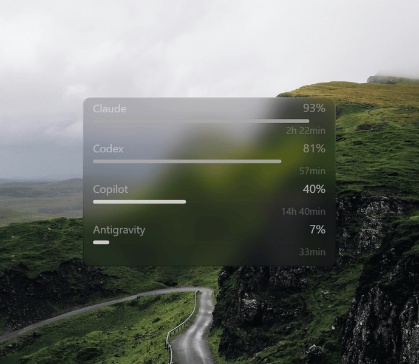
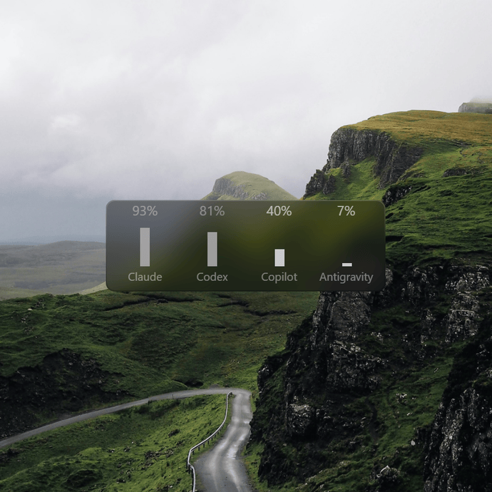

# AI Limits

<p align="center">
<a href="https://napxlexn.github.io/ailimits/"></a>
<a href="https://www.rust-lang.org/"></a>
<a href="https://github.com/napxlexn/ailimits/blob/master/LICENSE"></a>
<a href="https://github.com/napxlexn/ailimits/releases"></a>
<a href="https://github.com/napxlexn/ailimits/actions/workflows/ci.yml"></a>
<a href="https://github.com/napxlexn/ailimits/releases/latest"></a>
<a href="https://github.com/microsoft/winget-pkgs/tree/master/manifests/n/napxlexn/AILimits"></a>
<a href="https://community.chocolatey.org/packages/ailimits"></a>
<a href="https://github.com/napxlexn/scoop-ailimits"></a>
<a href="https://apps.microsoft.com/detail/9P2B0J1VWPWH"></a>
</p>

Een kleine, native zwevende overlay voor Windows 11 die de gebruikslimieten
van uw AI-providers direct op het bureaublad toont: **Claude**, **OpenAI Codex**,
**GitHub Copilot**, **Google Antigravity**, **xAI Grok**, **Cursor**.

<p align="center"><a href="https://napxlexn.github.io/ailimits/"></a></p>

<p align="center" class="languages"><a href="README.md">English</a> · <a href="README.uk.md">Українська</a> · <a href="README.zh-CN.md">简体中文</a> · <a href="README.ja.md">日本語</a> · <a href="README.es.md">Español</a> · <a href="README.pt-BR.md">Português (Brasil)</a> · <a href="README.de.md">Deutsch</a> · <a href="README.fr.md">Français</a> · <a href="README.pl.md">Polski</a> · <a href="README.it.md">Italiano</a> · <b>Nederlands</b> · <a href="README.cs.md">Čeština</a></p>

Verkrijgbaar in de [Microsoft Store](https://apps.microsoft.com/detail/9P2B0J1VWPWH), ondertekend en bijgewerkt door de Store, en vermeld op [AlternativeTo](https://alternativeto.net/software/ai-limits/about/) — als de app u helpt, helpt een like daar anderen hem te vinden.

<p align="center">
<a href="https://apps.microsoft.com/detail/9P2B0J1VWPWH"></a>
</p>

<p align="center">
  
  <br><sub>Drie detailniveaus: Compact, Medium, Expanded. Wisselen gebeurt live; de optionele prognose op basis van het verbruikstempo (~tijd tot de limiet) verschijnt op de metaregel waar geen resettijd bekend is. Hier met horizontale balken.</sub>
</p>

<p align="center">
  
  <br><sub>Met de widget verborgen blijft het verbruik zichtbaar op de taakbalk. Het systeemvakpictogram toont als twee ringen dezelfde twee providers als het paneel: de eerste twee in de widget, of de twee die u kiest. Bij aanwijzen van het paneel of het systeemvakpictogram verschijnt dezelfde lijst: de rijen die in de kolom Tooltip zijn aangevinkt. Beide volgen het lichte en donkere thema van het systeem.</sub>
</p>

<table>
<tr>
<td width="50%" align="center" valign="top">
  
  <br><sub>Dezelfde drie niveaus met verticale balken.</sub>
</td>
<td width="50%" align="center" valign="top">
  
  <br><sub>Drie breedtestappen. Bij de smalste vallen de providernamen weg en neemt de balk hun kolom in, zodat niets overlapt.</sub>
</td>
</tr>
<tr>
<td width="50%" align="center" valign="top">
  
  <br><sub>Dekking van de achtergrond, van bijna doorzichtig tot bijna dekkend. Het contrast van tekst en balken blijft gelijk.</sub>
</td>
<td width="50%" align="center" valign="top">
  
  <br><sub>De kaart past zich aan de getoonde rijen aan: één per ingeschakelde provider, plus de extra rijen die u kiest.</sub>
</td>
</tr>
<tr>
<td width="50%" align="center" valign="top">
  
  <br><sub>Monochroom plus acht kleurenpaletten, met helderheid, verzadiging en achtergronddekking. Weergegeven door de app zelf.</sub>
</td>
<td width="50%" align="center" valign="top">
  
  <br><sub>Met verticale balken staan providers naast elkaar of gestapeld in een kolom.</sub>
</td>
</tr>
<tr>
<td width="50%" align="center" valign="top">
  
  <br><sub><em>Settings</em>, Providers: een aangevinkte rij verschijnt meteen op de widget; Sign-in van elke provider vermeldt wat er wordt gelezen en waar het token naartoe gaat.</sub>
</td>
<td width="50%" align="center" valign="top">
  
  <br><sub><em>Settings</em>, Display: wat elke rij toont; zonder de balk wordt de widget kleiner. Getekend door de app zelf.</sub>
</td>
</tr>
</table>

## Wat het doet

- **Leest, schrijft nooit.** De app leest de tokens die de officiële CLI-tools
  al op uw computer opslaan. Ze worden nooit vernieuwd of geroteerd, dus de app
  kan u niet afmelden bij die tools. Cursor is de enige uitzondering: daar meldt
  de app zich aan met een eigen sessie, en de aanmelding van de editor wordt
  nooit gelezen of aangeraakt. Sleutels die u zelf toevoegt, en die sessie,
  worden opgeslagen in Windows Credential Manager. De app maakt alleen
  verbinding met de eigen endpoints van de providers (en, bij installatie via
  het installatieprogramma, met GitHub voor updates), doet één gebruiksverzoek
  per provider per cyclus (plus de paar hulpverzoeken die in
  [docs/en/PROVIDERS.md](docs/en/PROVIDERS.md#requests-per-cycle) (in het Engels) staan),
  volgt de proxy die in Windows is ingesteld en verstuurt geen telemetrie.
- **Vraagt voordat het leest.** Niets van een andere tool wordt gelezen
  voordat u daar toestemming voor geeft, en elke vraag noemt het bestand en
  waar het token naartoe wordt gestuurd. Elke vraag wordt één keer gesteld, en
  *Forget permission* trekt de toestemming met één klik weer in. Zie
  [Wat er wordt gelezen, en wanneer](docs/en/CONFIG.md#what-is-read-and-when) (in het Engels).
- **Weinig instellen.** Bij de eerste start zijn de tools die op deze pc zijn
  gevonden al aangevinkt, en één vraag noemt elk aanmeldingsbestand dat de app
  zou lezen: *Allow* is genoeg. Daarna houdt uw normale CLI-gebruik hun tokens
  geldig, dus er valt verder niets in te stellen. Alleen Cursor vraagt u om u
  één keer aan te melden, in *Settings*.
- **Lage belasting, gemeten aan de draaiende app.** 0.014% van één CPU-kern,
  geen GPU-gebruik (de app rendert op de CPU), een working set van 53 MB
  (25 MB privé), gemeten voor 0.7.1 op 2026-11-23; geen verhoogde
  timerresolutie (2026-11-21); een exe van 4 MB. Na te meten met
  `bench/perf_audit.ps1`; de volledige cijfers staan in
  [docs/en/ARCHITECTURE.md](docs/en/ARCHITECTURE.md#resource-footprint-measured-not-estimated) (in het Engels).
- **Verouderde gegevens worden als verouderd gemarkeerd.** Een waarde die niet
  meer wordt bijgewerkt, wordt grijs en toont hoe oud ze is. Een limietvenster
  dat aantoonbaar is gereset, toont `≈0%`. De app vult geen gaten met
  gissingen. Het opvragen pauzeert terwijl u weg bent, en die tijd telt niet
  mee: niets wordt grijs alleen omdat u even weg was.
- **Op zichzelf staand.** Statisch gelinkt, dus geen Visual C++
  Redistributable en geen meegeleverde DLL's. Het installatieprogramma heeft
  geen beheerdersrechten nodig.

## Installatie

> **Werkt u bij vanaf 0.7.0 (of 0.6.x) en bevat het pad van uw
> gebruikersprofiel of TEMP-map letters buiten het Engelse alfabet
> (bijvoorbeeld Cyrillisch), `&` of `%`?** De updater van de oude versie loopt
> op zo'n pad vast: zodra 0.7.1 uit is, kan hij AI Limits ongeveer een halve
> minuut na elke start afsluiten. Installeer 0.7.1 handmatig: download
> `AiLimits-Setup-0.7.1.exe` via
> [Releases](https://github.com/napxlexn/ailimits/releases) en voer het uit,
> of voer, zodra winget 0.7.1 aanbiedt, `winget upgrade napxlexn.AILimits` uit.
> Als de widget sluit voordat u eraan toekomt, klik er dan direct na een start
> met de rechtermuisknop op en vink eerst **Automatic updates** uit (of zet
> `auto_update = false` in `%APPDATA%\AiLimits\config.toml`). Vanaf 0.7.1
> start de updater het installatieprogramma rechtstreeks, werken zulke paden
> en kunt u Automatic updates weer aanvinken.

Vanuit de terminal:

```powershell
# winget
winget install napxlexn.AILimits

# one-line install: downloads the latest release, verifies its SHA-256
# against the published digest (the SHA-256 only, not the .sig), runs the
# silent per-user install (no admin rights)
irm https://raw.githubusercontent.com/napxlexn/ailimits/master/install.ps1 | iex

# Scoop, from the project's own bucket
scoop bucket add ailimits https://github.com/napxlexn/scoop-ailimits
scoop install ailimits

# Chocolatey
choco install ailimits

# Microsoft Store (signed and updated by the Store), or https://apps.microsoft.com/detail/9P2B0J1VWPWH
winget install --id 9P2B0J1VWPWH --source msstore
```

Of haal de app uit de [Microsoft Store](https://apps.microsoft.com/detail/9P2B0J1VWPWH):
dezelfde widget, ondertekend en up-to-date gehouden door de Store (hij kan een
paar dagen achterlopen op een release terwijl een nieuw pakket wordt
gecertificeerd).

Of download `AiLimits-Setup-<version>.exe` via
[Releases](https://github.com/napxlexn/ailimits/releases) en voer het uit.
Er zijn geen beheerdersrechten nodig (installeert naar `%LOCALAPPDATA%\AiLimits`).
Optioneel tijdens de installatie: automatisch starten met Windows (standaard
aangevinkt) en een snelkoppeling op het bureaublad. winget en Chocolatey voeren
ditzelfde installatieprogramma uit, dus hun kopie werkt zichzelf bij zoals elke
kopie die met het installatieprogramma is geïnstalleerd, en de pakketbeheerder
kan een oudere versie vermelden dan de versie die draait.
Bij elke release hoort ook een portable zip (zonder installatieprogramma). Een
portable kopie werkt zichzelf niet bij: dat doet de pakketbeheerder ervan, of u
zelf. Er is geen portable modus voor instellingen: elke kopie, ook een portable,
bewaart ze in `%APPDATA%\AiLimits`.

> Het installatieprogramma is **niet digitaal ondertekend** (Authenticode), dus
> Windows SmartScreen kan "Windows heeft uw pc beschermd" tonen. Klik op
> **Meer informatie → Toch uitvoeren**. U kunt de download controleren aan de
> hand van de SHA-256 die bij elke release wordt gepubliceerd (zie hieronder).
> Vanaf 0.7.1 bevat elke release ook een Ed25519-handtekening (`.sig`) voor het
> installatieprogramma en de zip, en vanaf 0.7.1 installeert de eigen updater
> van de app niets zonder een geldige handtekening. De updater van 0.7.0
> negeert de `.sig` en controleert alleen de SHA-256 die GitHub voor het
> installatieprogramma publiceert: zijn update naar 0.7.1 berust op die digest.

Om een download handmatig te controleren, vergelijkt u de SHA-256 ervan met de
digest `sha256:` die naast het bestand op de releasepagina staat; de twee
moeten overeenkomen:

```powershell
(Get-FileHash .\AiLimits-Setup-0.7.1.exe -Algorithm SHA256).Hash
```

Om ook de handtekening te controleren, zet u de `.sig` naast het bestand, beide
onder hun gepubliceerde naam (de handtekening dekt ook de naam). Voer daarna, in
een kloon van deze repository die op de releasetag staat (`git checkout v0.7.1`),
de opdracht `verify` van de release-signer uit, die geen sleutel nodig heeft
(Rust, zoals in [Bouwen vanaf de broncode](#bouwen-vanaf-de-broncode)):

```powershell
cargo run --locked --release --manifest-path tools/release-signer/Cargo.toml -- verify $HOME\Downloads\AiLimits-Setup-0.7.1.exe
```

Die geeft `verified` weer, of `NOT verified` met de reden.

Het installatieprogramma bevat geen sleutels of tokens. Bij de eerste start
leest de widget geen van de hieronder vermelde aanmeldingsbronnen totdat u dat
toestaat.

### Verwijderen

Verwijderen in Windows via Instellingen, Apps, met
`winget uninstall napxlexn.AILimits` of met `choco uninstall ailimits` voert het
verwijderprogramma van het installatieprogramma uit. Dat sluit AI Limits af en
verwijdert, offline: de installatiemap, `%APPDATA%\AiLimits` (instellingen,
cache, logboeken), elke vermelding in Credential Manager die de app heeft
aangemaakt (sleutels, tokens, de Cursor-sessie), de autostartwaarde en de
registratie voor meldingen.

Het verwijderen van een Scoop- of portable kopie ruimt daar niets van op:
`scoop uninstall ailimits`, of de map wissen, verwijdert alleen de eigen
bestanden van de app. Sluit AI Limits af voordat u de kopie verwijdert, en voer
in de map ervan het volgende uit (een opdracht die niets te verwijderen heeft,
doet niets):

```
ailimits-auth remove claude
ailimits-auth remove copilot
ailimits-auth remove-usage-token claude
ailimits-auth remove-usage-token codex
ailimits-auth logout cursor
```

Verwijder daarna `%APPDATA%\AiLimits` en de registersleutel
`HKCU\Software\Classes\AppUserModelId\napxlexn.AILimits` (de naam en het
pictogram die de meldingen van de app tonen). Een kopie uit de Microsoft Store:
hoe u eerst de sleutels ervan verwijdert, staat in
[docs/en/CONFIG.md](docs/en/CONFIG.md#secrets) (in het Engels); bij het
verwijderen gaat de eigen instellingenmap mee (de map van de Store-kopie wordt
bovenaan dat bestand beschreven).

## Snel aan de slag

1. **Start de app.** Bij de eerste start opent een welkomstvenster (hetzelfde
   als *Settings…* in het menu). De vraag daarin somt de tools op die op deze
   pc zijn gevonden (Claude Code, Codex CLI, de Copilot CLI of GitHub CLI,
   Antigravity, de Grok CLI, Cursor), elk met een vinkje, en noemt elk bestand
   dat de app zou lezen en waar elk token naartoe gaat. Tools die aan een eigen
   map zijn herkend, staan al aangevinkt; alleen GitHub CLI (voor Copilot) of
   alleen `.gemini` (voor Antigravity) wordt zonder vinkje vermeld.
   *Allow* start de aangevinkte tools; *Cancel* leest niets en laat u
   aanvinken wat u wilt, waarbij elke tool één keer vraagt. Het venster neemt
   geen toetsenbordfocus (Enter staat dus nooit per ongeluk iets toe) en wacht
   zolang een app op volledig scherm op de voorgrond staat. Net als *Settings*
   blijft het open totdat Esc, het kruisje of Alt+F4 het sluit, en het laat
   zich aan de titelbalk verslepen. Cursor heeft één keer een eigen aanmelding
   van de app nodig: open in hetzelfde venster de regel *Sign-in* onder Cursor
   en klik op *Sign in to Cursor…*.
   Bijwerken vanaf 0.7.0 vraagt niets: de providers die u had, blijven werken,
   en één venster somt op wat er wordt gelezen.
2. **Plaats de widget.** Sleep met de linkermuisknop. Houd tijdens het slepen
   **Shift** ingedrukt om de widget strak tegen de dichtstbijzijnde rand van het
   werkgebied van de monitor te trekken (het scherm zonder de taakbalk), zodra
   hij binnen 64 px van die rand is.
   `Lock position` in het rechtsklikmenu zet hem vast.
3. **Stel het uiterlijk in.** Klik met de rechtermuisknop voor het detailniveau
   (Compact, Medium, Expanded), de indeling (Rows of Columns), het palet
   (monochroom of 8 kleuren), dekking, helderheid en verzadiging. De animaties
   hierboven tonen ze allemaal.
   Rust de aanwijzer op een van deze items, of op Width, Column layout of
   Usage forecast, dan ziet u het resultaat op de widget, het paneel en het
   systeemvakpictogram al voordat u klikt, en hetzelfde gebeurt als u er met het
   toetsenbord naartoe gaat; het menu verlaten zonder te klikken zet alles terug.
   *Settings…*
   kiest de rijen die de widget en de tooltip van het paneel tonen (inclusief
   extra rijen zoals de Opus-week van Claude), een optioneel label met het
   gebruikte model (model, versie, redeneerniveau) en waar de aanmelding van
   elke provider vandaan komt. *Model source* bepaalt waar het model van het
   label vandaan komt: *Tool settings*, of *Last session*, het model van de
   nieuwste sessie van Claude Code of Codex CLI, gelezen uit het einde van het
   bestand ervan (hoogstens de laatste 1 MB); andere tools tonen het model zoals
   het is ingesteld.
   De kolom Taskbar kiest de twee providers die het paneel en het
   systeemvakpictogram tonen; er blijft er minstens één aangevinkt. Percentage
   en Time to reset worden apart aangevinkt voor de tooltip van het paneel
   (kolom Tooltip) en voor het paneel zelf (kolom Taskbar): het percentage, de
   tijd tot de limiet wordt gereset, of beide; de laatste die nog aan staat, kan
   niet worden uitgevinkt. Progress bar (standaard aan) kan de balk van het
   paneel weglaten, zodat het minder van de taakbalk inneemt.
4. **Houd de muis op een providerrij** om de wekelijkse limiet ervan te zien, in
   plaats van het aftellen tot de reset (in Compact op de onderste regel).
   Een grijze rij of een rij met `≈` toont in plaats daarvan de oorzaak en de
   oplossing, bijvoorbeeld `token expired — run Claude Code`. De oorzaak
   verschijnt volledig in rijen bij Medium en Expanded en op de onderste regel
   van Compact (bij de breedtes 100% en 75%), passend ingekort onder een kolom
   bij Expanded; kolommen bij Compact en Medium, en Compact op 50%, tonen er
   geen.
5. **Zit de widget in de weg?** Klik met de rechtermuisknop, **Taskbar**, en dan
   *Taskbar panel* of *Tray icon*. Als de widget verborgen is of door andere
   vensters wordt bedekt, blijft het verbruik op de taakbalk zichtbaar; zolang
   een app op volledig scherm het scherm vult, verdwijnt de weergave met de
   taakbalk en komt ze terug als u de app verlaat. Zie
   [Taakbalkindicator](#taakbalkindicator).
6. **Klik met de linkermuisknop op het systeemvakpictogram of het paneel** om de
   widget naar voren te halen of te verbergen.
   Klik met de rechtermuisknop op een van beide voor hetzelfde menu.
7. **Een melding in plaats van rijen?** *Setup required* of
   *No data yet*: klik op de widget om *Settings* te openen.
   *Right-click → set up providers*: er zijn providers aangevinkt, maar geen
   ervan is aangemeld; controleer *Sign-in* van elke provider in *Settings*.

## Hoe autorisatie werkt

De widget vraagt u nooit om in te loggen, behalve één keer voor Cursor. Hij
bewaakt de limieten van uw **abonnement** door de tokens te hergebruiken die de
officiële CLI-tools op uw computer bewaren, strikt alleen-lezen en pas nadat u
elk ervan hebt toegestaan:

| Provider | Automatische bron (standaard) | Inschakelen |
|---|---|---|
| Claude | `%USERPROFILE%\.claude\.credentials.json` (OAuth-token van Claude Code) | voer [Claude Code](https://claude.com/claude-code) minstens één keer uit |
| Codex | `%USERPROFILE%\.codex\auth.json` (token van Codex CLI; in `CODEX_HOME` als die is ingesteld) | voer één keer `codex login` uit |
| Copilot | `gh auth token --hostname github.com` (GitHub CLI) | één keer `gh auth login` |
| Antigravity | Windows Credential Manager, doel `gemini:antigravity` | voer `agy` uit, de Antigravity CLI; het token blijft ongeveer een uur geldig en alleen `agy` vernieuwt het (de editor openen doet dat niet) |
| Grok | `%USERPROFILE%\.grok\auth.json` (aanmelding van Grok CLI; in `GROK_HOME` als die is ingesteld) | voer `grok` uit en meld u één keer aan (een SuperGrok-abonnement) |
| Cursor | de eigen sessie van de widget, in Windows Credential Manager (`cursor_session`); daarvoor wordt niets van de Cursor-editor gelezen | Meld u één keer aan bij Cursor in *Settings* (*Sign-in* van Cursor, *Sign in to Cursor…*) of met `ailimits-auth login cursor`: de eigen aanmeldingspagina van Cursor opent in de browser; sessie van ~60 dagen |

Onder de rijen van elke provider op het tabblad *Providers* heeft *Settings*
een regel *Sign-in* die vermeldt waar de aanmelding vandaan komt en hoe die
verliep ("Claude Code · connected"). Open die regel om de bron te kiezen: het
account van de tool hierboven (*Claude Code account* enzovoort) of, voor Claude,
Codex en Copilot, een eigen sleutel of token (zie Handmatige autorisatie
hieronder). Alleen de gekozen bron wordt gebruikt; als die faalt, neemt geen
andere het over.

Per tool wordt één keer gevraagd. Als u alle rijen van een provider uitvinkt
(Widget, Tooltip en Taskbar), wordt die gepauzeerd: er wordt niets van gelezen
of verstuurd, en één vinkje start hem weer zonder vraag. Om de toestemming in
te trekken, opent u *Sign-in* van die provider en klikt u op *Forget permission*
(zichtbaar zolang de eigen aanmelding van de tool de bron is): de aanmelding
wordt niet meer gelezen, de rijen worden uitgevinkt, en bij het volgende vinkje
wordt opnieuw gevraagd. De sessie van Cursor eindigt met *Sign out*, een
geplakte sleutel of token verdwijnt met *Remove*. Het lezen voor het modellabel
heeft een eigen *Forget permission* op het tabblad *Display*, onder Model,
Version en Reasoning effort. Toestemmingen worden per Windows-gebruiker bewaard,
in de `config.toml` van die gebruiker.

Codex CLI schrijft `auth.json` alleen als het zijn aanmelding in een bestand
bewaart: met `cli_auth_credentials_store = "keyring"` of `"auto"` in zijn
`config.toml` is er geen `auth.json`, en kan de aanmelding niet worden gelezen.
Zet de waarde op `"file"`, of plak in plaats daarvan een usage token.

Dit zijn OAuth-toegangstokens, kortlevend, behalve dat van Cursor. De CLI waar
een token bij hoort, vernieuwt het telkens wanneer u die CLI gebruikt. De widget
vernieuwt nooit het token van een andere app, omdat een OAuth-vernieuwing het
token roteert en de CLI zou afmelden. De Cursor-sessie (ongeveer 60 dagen) is
van de widget zelf: u meldt zich in de browser aan bij Cursor, op de eigen
pagina van Cursor, en de widget bewaart en vernieuwt die sessie zelf. Cursor
heeft geen aanmelding voor andere apps, dus de widget meldt zich aan als de
client van de Cursor-editor; de aanmelding van de editor leest hij nooit.
`CODEX_HOME`, `GROK_HOME` en `COPILOT_HOME` tellen alleen mee als het absolute
paden zijn.

### Hoe lang de gegevens zonder ingrijpen kloppen

| Provider | Live gegevens blijven | Daarna |
|---|---|---|
| **Claude** | ~8 uur na uw laatste sessie van Claude Code (de werkelijke levensduur van het token) | toont de laatste waarde grijs, met de ouderdom ervan |
| **Codex** | zolang u Codex CLI gebruikt (hoe lang het token geldig blijft, is nog niet gemeten) | de laatste waarde grijs, met de ouderdom ervan |
| **Copilot** | Onbeperkt. gh houdt het token vers zolang u aangemeld blijft. | |
| **Antigravity** | ongeveer een uur nadat `agy` voor het laatst draaide (alleen `agy` vernieuwt het token) | de laatste waarde grijs, met de ouderdom ervan |
| **Grok** | tot ~6 uur na uw laatste sessie van Grok CLI (de werkelijke levensduur van het token) | de laatste waarde grijs, met de ouderdom ervan |
| **Cursor** | ongeveer 60 dagen nadat u zich aanmeldt (de levensduur van de sessie) | de laatste waarde grijs, en `sign in to Cursor again` |

Google is op 18 juni 2026 gestopt met het verwerken van Gemini CLI-verzoeken
voor individuele gebruikers en gebruikers van Google AI Pro en Google AI Ultra.
Van die gebruikers wordt verwacht dat ze overstappen op Antigravity CLI; de
widget leest alleen het token van Antigravity in Windows Credential Manager, en
niet langer het oude bestand van Gemini CLI. Google heeft sommige accounts
geschorst omdat de aanmelding van Antigravity buiten Antigravity werd gebruikt.
De widget leest alleen uw quotum, één keer per update, maar het risico ligt bij
u: de vraag om de aanmelding van Antigravity te mogen lezen, vermeldt dat ook.

**Claude heeft aan de serverkant een limiet op hoe vaak het kan worden
uitgelezen.** Anthropic past rate limiting toe op het usage-endpoint (HTTP 429,
`Retry-After: 0`, geverifieerd op 2026-07-09), en het budget per token wordt
gedeeld met het eigen opvragen door Claude Code. Terwijl Claude Code draait, kan
het vernieuwen van Claude 2 tot 3 minuten duren, zelfs bij het interval van
1 minuut. De volgende cyclus vraagt opnieuw op het update-interval; de wachttijd
loopt alleen op (2, 4, daarna hoogstens 5 minuten bij het interval van
1 minuut) als geen enkele provider in een cyclus gegevens opleverde, en een rate
limit telt als geen gegevens. Intussen toont de Claude-rij bij aanwijzen
`rate-limited, retrying`. Andere providers merken hier niets van.

Een verlopen token van Claude, Codex, Antigravity, Grok of Cursor levert geen
verkeerde cijfers op. De laatste waarde blijft grijs staan met de ouderdom
ervan, een venster dat aantoonbaar is gereset, toont `≈0%`, en het aftellen tot
de reset loopt lokaal door. Als u de CLI's dagelijks gebruikt, zijn de gegevens
bijna altijd live.

### Handmatige autorisatie (voor onafhankelijkheid of opstellingen zonder CLI)

Voor opstellingen zonder de CLI's, of als u een referentie wilt die niet afhangt
van CLI-activiteit. Wat elke optie u werkelijk oplevert:

| Provider | Handmatige optie | Waar te verkrijgen | Toont hetzelfde als het abonnement? |
|---|---|---|---|
| **Copilot** | Een fine-grained Personal Access Token; het heeft helemaal geen machtigingen nodig (laat ze leeg) | github.com/settings/personal-access-tokens, *Generate new token* | Live geverifieerd op 2026-11-21: een token zonder machtigingen leest dezelfde quota als de aanmelding van GitHub CLI. Er is geen gh voor nodig, tot de vervaldatum die u instelt. |
| **Claude** | API-sleutel | console.anthropic.com, Settings, API Keys, *Create Key* (`sk-ant-…`) | Nee. Het toont de rate limits van uw API-account, niet het verbruik van uw Pro- of Max-abonnement. |
| **Codex** | Geen | Er bestaat geen apart stabiel token. Een geplakt *Usage token* is hetzelfde soort OAuth-token als dat van Codex CLI. | |
| **Antigravity** | Geen | Het quotum is gekoppeld aan het OAuth-token dat Antigravity CLI vernieuwt, en geen enkele aparte sleutel meldt dezelfde cijfers. | |
| **Grok** | Geen | De wekelijkse SuperGrok-limiet wordt alleen met de eigen aanmelding van Grok CLI gelezen. | |
| **Cursor** | De eigen aanmelding, ongeveer 60 dagen | *Settings*, *Sign-in* van Cursor, *Sign in to Cursor…*, of `ailimits-auth login cursor` | Ja. Het is het eigen verbruik van het abonnement. |

**Twee manieren om een referentie toe te voegen:**

1. **In *Settings*.** Kopieer de sleutel of het token. Open de regel
   *Sign-in* van de provider, kies de bron (Claude: *Usage token* of *API key*;
   Codex: *Usage token*; Copilot: *Fine-grained token*) en klik op
   *Paste token from clipboard*
   (*Paste key from clipboard* voor de API-sleutel van Claude). Alleen dat soort
   geheim wordt aangenomen (`sk-ant-...`; `ghp_...`, `github_pat_...`, `gho_...`,
   `ghu_...` of een klassiek hexadecimaal token van 40 tekens; een ChatGPT-token
   `eyJ...`): al het andere op het klembord wordt geweigerd zonder te worden
   verstuurd, en nooit getoond of gelogd. Een usage token wordt eerst met één
   verzoek gecontroleerd: een geweigerd token wordt niet opgeslagen. Een sleutel
   wordt opgeslagen zoals hij is, en de rij laat zien of hij werkt. Het venster
   meldt de uitkomst (met een melding als het venster intussen is gesloten), en
   het geheim gaat rechtstreeks naar Credential Manager. Alleen de gekozen bron
   wordt gebruikt: de aanmelding van de tool wordt niet gelezen zolang uw token
   of sleutel is gekozen, en een opgeslagen token wordt niet verstuurd zolang
   het account van de tool is gekozen.
2. **Vanuit de terminal.** `ailimits-auth.exe` staat naast de widget in
   `%LOCALAPPDATA%\AiLimits`:
   ```
   ailimits-auth status                       # show every detected source
   ailimits-auth set copilot                  # store a PAT (hidden input)
   ailimits-auth set claude                   # store a Claude API key
   ailimits-auth set-usage-token claude|codex # store a manual usage token
   ailimits-auth remove copilot|claude
   ailimits-auth remove-usage-token claude|codex
   ailimits-auth login cursor                 # sign in to Cursor in the browser
   ailimits-auth logout cursor                # forget that session
   ```
   `set-usage-token` controleert het token met één verzoek aan het
   usage-endpoint van de provider: een geweigerd token (401/403) wordt niet
   opgeslagen; een rate limit (429) telt als geaccepteerd; zonder antwoord dat
   de doorslag geeft, vraagt het na 2 en na 4 seconden opnieuw en slaat het
   token daarna op met een opmerking. `status` verandert niets en leest de
   aanmelding van een andere tool alleen waar de widget dat mag. Een draaiende
   widget pikt wat de andere opdrachten veranderen vanzelf op, zonder herstart:
   een gewijzigde instelling binnen een paar seconden, een nieuwe of verwijderde
   sleutel of token bij de volgende update. `set` en `set-usage-token` maken van
   wat ze opslaan de bron van de provider.

**Terug naar de aanmelding van de tool:** kies in *Sign-in* van de provider het
account van de tool (*Claude Code account*, *Codex CLI account* of *GitHub CLI account*).
Uw sleutel of token blijft opgeslagen maar ongebruikt; *Remove*, met die bron
gekozen, verwijdert hem. Vanuit de terminal verwijdert
`ailimits-auth remove claude|copilot` de sleutel en schakelt terug;
`remove-usage-token` verwijdert het token maar laat de bron erop staan, zodat de
rij verborgen blijft totdat u in het venster het account van de tool kiest.

## Het contextmenu

Klik met de rechtermuisknop op de widget:

- `Settings…`: rijen, modellabels, modelaliassen, de aanmelding van elke provider.
- **Detail**: Compact / Medium / Expanded.
- **Layout**: Rows / Columns, daarna Width (100 / 75 / 50%, grijs tenzij
  Rows) en Column layout (Side by side / Stacked, grijs tenzij Columns).
- **Appearance**: Palette (8 kleuren), Monochrome, Background opacity,
  Brightness, Saturation.
- **Taskbar**: Tray icon / Taskbar panel / None, en Panel display als er meer
  dan één taakbalk is.
- `Always on top` en `Lock position` (twee onafhankelijke schakelaars), Usage
  forecast ("~tijd tot de limiet" op basis van het verbruikstempo, standaard uit).
- Refresh interval (1 / 5 / 15 / 30 min) en `Automatic updates` (stille
  zelfupdate op de achtergrond van een kopie die met het installatieprogramma is
  geïnstalleerd, standaard aan; kopieën uit de Store, van Scoop, portable en
  zelf gebouwde kopieën hebben dit item niet). Een nieuwe versie wordt één keer
  gemeld, in een melding met *Install now* en *What's new*; zonder actie
  installeert ze zichzelf de volgende keer dat u vijf minuten weg bent.
- *AI Limits 0.7.1*, met het GitHub-logo (opent de projectpagina), en Quit.

Usage forecast toont zijn ~tijd in rijen bij Medium en Expanded en in kolommen
bij Expanded, alleen waar geen resettijd bekend is, en nooit voor gegevens die
niet meer worden bijgewerkt.

### Taakbalkindicator

Als de overlay verborgen is of door andere vensters wordt bedekt, blijft er een
compacte verbruiksweergave op de taakbalk staan; zolang een app op volledig
scherm het scherm vult, verdwijnt die met de taakbalk en komt terug als u de app
verlaat. Rechtermuisknop →
**Taskbar**:

- **Tray icon** (de standaard). Eén pictogram van 16px: twee concentrische
  ringen voor dezelfde twee providers die het paneel toont (de eerste twee in de
  widget, of de twee die in de kolom Taskbar van *Settings* zijn aangevinkt), de
  drukste aan de buitenkant, beide vullend met de klok mee vanaf 12 uur.
  Monochroom, getekend in het taakbalkthema van het systeem.
- **Taskbar panel.** Een transparante overlay naast de klok. Er is geen venster
  of kader, alleen cijfers en balken ter grootte van de klok, over de taakbalk
  getekend. Het paneel is monochroom, volgt het lichte en donkere thema van het
  systeem, toont de eerste twee providers in de volgorde van de widget, of de
  twee die in de kolom Taskbar van *Settings* zijn aangevinkt, met hun
  percentage (en de balk daarvan, tenzij Progress bar daar is uitgevinkt), de
  tijd tot hun limiet wordt gereset, of beide (een waarde die niet meer wordt
  bijgewerkt, of een schatting met `≈`, wordt gedimd getekend, zoals de widget
  die grijs maakt), en volgt de taakbalk als die beweegt (automatisch
  verbergen, wijzigingen in de resolutie, breedte van het systeemvak). Houd de
  muis erop voor een tooltip met de rijen die in de kolom Tooltip zijn
  aangevinkt (standaard elke provider), elk met het percentage en het moment
  van de reset.
  Als Start, Zoeken of de automatisch verborgen taakbalk het paneel bedekt,
  nemen de ringen in het systeemvak het over, en het paneel komt vanzelf terug.
  Als een app op volledig scherm het scherm overneemt, verdwijnt het paneel met
  de taakbalk en keert het terug als u met Alt+Tab wegschakelt. Het werkt op een
  taakbalk aan elke rand van het scherm: op een zijbalk staan de twee providers
  onder elkaar, percentage boven balk, boven het systeemvak. Een taakbalk zonder
  vrije ruimte tussen de laatste app-knop en het systeemvak krijgt geen paneel;
  de ringen in het systeemvak nemen het over totdat er ruimte komt, zodat het
  paneel nooit over de knoppen heen ligt.
- **None.** Geen indicator.

Als Windows de taakbalk op meer dan één beeldscherm toont, kiest
**Taskbar → Panel display** aan welke taakbalk het paneel zich hecht. Het
submenu verschijnt alleen als er een tweede taakbalk is; als het gekozen
beeldscherm later wordt losgekoppeld, valt het paneel terug op de primaire
taakbalk. Het menu wordt opgebouwd wanneer de app start, dus een later
aangesloten beeldscherm verschijnt daar pas na een herstart. *Display 2*,
*Display 3* enzovoort zijn de andere taakbalken, van links naar rechts geteld,
niet de eigen schermnummers van Windows.

Met de linkermuisknop op het systeemvakpictogram of het paneel klikken haalt de
widget naar voren (of verbergt hem als hij al vooraan staat); met de
rechtermuisknop **ergens op het paneel** klikken opent ditzelfde menu.

## Configuratie en diagnostiek

`%APPDATA%\AiLimits\config.toml` wordt automatisch aangemaakt, en elke wijziging
in het menu wordt daarin opgeslagen. Wijzigingen die u erin opslaat, worden
toegepast terwijl de app draait, binnen ongeveer twee seconden, zonder herstart;
*Edit config.toml…* onderaan het tabblad *Display* van *Settings* opent het
bestand in Notepad. Een regel die niet kan worden gelezen, wordt overgeslagen en
genoemd, en de standaardwaarde wordt gebruikt. Het bestand legt zichzelf uit:
een korte notitie voor elke instelling vermeldt wat die doet, welke waarden ze
aanneemt en wat de standaardwaarde is. Naslag voor het formaat:
[docs/en/CONFIG.md](docs/en/CONFIG.md) (in het Engels).
Fijnafstemming buiten het menu (afmetingen, kleuren, drempels): [docs/en/TUNING.md](docs/en/TUNING.md) (in het Engels).

Stel `AILIMITS_LOG=ailimits=debug` of `RUST_LOG=ailimits=debug` in om een
diagnostisch logboek naar `%APPDATA%\AiLimits\ailimits.log` te schrijven (stderr
is onzichtbaar in een GUI-app). Het bestand roteert bij 5 MB: het vorige wordt
bewaard als `ailimits.log.1`.

Een crash laat één regel achter in `%APPDATA%\AiLimits\crash.log` (tijd, versie,
thread, locatie in de broncode; nooit de tekst van de crashmelding); een
mislukte start meldt dat in een bericht en in dat bestand. AI Limits opnieuw
starten terwijl het al draait, toont de widget en haalt hem naar voren.

Een drempelmelding verschijnt één keer per limietvenster, wanneer het verbruik
de `alert_threshold` van de provider bereikt (standaard 80%, 85% voor Copilot);
opnieuw pas nadat het venster is gereset, of nadat het verbruik meer dan
5 punten onder de drempel is gezakt en weer is gestegen. `[notifications]` in de
configuratie schakelt meldingen uit (`enabled = false`) en stelt de kortste
tussenpoos in tussen twee meldingen van één provider (`cooldown_minutes`).

Verzoeken volgen de proxy die in Windows is ingesteld (Instellingen, Netwerk,
Proxy, "Een proxyserver gebruiken"); `HTTPS_PROXY`, `HTTP_PROXY` en `ALL_PROXY`
gaan voor, een proxyscript (PAC) wordt niet gevolgd. `ailimits-auth` volgt
alleen de variabelen, niet de Windows-instelling. Een netwerk dat TLS
inspecteert met een eigen rootcertificaat, wordt niet vertrouwd: de rijen tonen
dan "untrusted certificate, retrying".

## Bouwen vanaf de broncode

Vereist Rust 1.90 of nieuwer met de MSVC-toolchain: Visual Studio Build Tools
met de C++-workload en de Windows SDK, waarvan `rc.exe` het pictogram, het
manifest en de versie insluit (zie `build.rs`). Het installatieprogramma wordt
met Inno Setup 6.7.4 gebouwd uit de exe's van `release-min`. Een kopie die vanuit
`target\` draait, werkt zichzelf niet bij en heeft geen item *Automatic updates*.

```
# Rust 1.90+ (MSVC), Windows 11
cargo build --profile release-min --locked   # ~4 MB exe in target/release-min/
cargo test --locked
ISCC.exe installer\ailimits.iss              # the installer, in target/installer/
```

Documentatie voor ontwikkelaars: [docs/en/](docs/en/) (in het Engels).

## Licentie

Copyright (C) 2026 napxlexn.

AI Limits is vrije software, uitgebracht onder de
[GNU General Public License, versie 3 of later](LICENSE). U mag de software
gebruiken, bestuderen, aanpassen en opnieuw verspreiden. Als u een aangepaste
versie verspreidt, moet u de bijbehorende broncode onder dezelfde licentie
beschikbaar stellen, de copyright- en licentievermeldingen behouden en uw
wijzigingen duidelijk markeren.

De GPL-licentie van de software geeft geen recht om aangepaste builds te
presenteren als officiële releases van AI Limits. Zie [TRADEMARKS.md](TRADEMARKS.md)
voor de regels rond de projectnaam en het logo. Componenten van derden blijven
onder hun eigen licenties vallen; hun vermeldingen worden met elke kopie
meegeleverd in [THIRD-PARTY-NOTICES.txt](THIRD-PARTY-NOTICES.txt).
