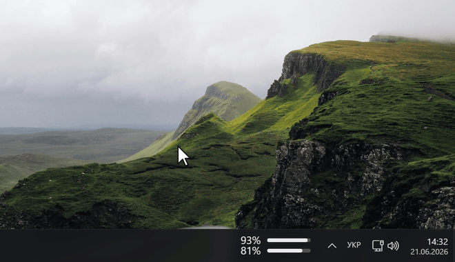

# AI Limits

<p align="center">
<a href="https://napxlexn.github.io/ailimits/"></a>
<a href="https://www.rust-lang.org/"></a>
<a href="https://github.com/napxlexn/ailimits/blob/master/LICENSE"></a>
<a href="https://github.com/napxlexn/ailimits/releases"></a>
<a href="https://github.com/napxlexn/ailimits/actions/workflows/ci.yml"></a>
<a href="https://github.com/napxlexn/ailimits/releases/latest"></a>
<a href="https://github.com/microsoft/winget-pkgs/tree/master/manifests/n/napxlexn/AILimits"></a>
<a href="https://community.chocolatey.org/packages/ailimits"></a>
<a href="https://github.com/napxlexn/scoop-ailimits"></a>
<a href="https://apps.microsoft.com/detail/9P2B0J1VWPWH"></a>
</p>

Uma pequena sobreposição flutuante nativa para Windows 11 que mostra os limites
de uso dos seus provedores de IA direto na área de trabalho: **Claude**,
**OpenAI Codex**, **GitHub Copilot**, **Google Antigravity**, **xAI Grok**, **Cursor**.

<p align="center"><a href="https://napxlexn.github.io/ailimits/"></a></p>

<p align="center" class="languages"><a href="README.md">English</a> · <a href="README.uk.md">Українська</a> · <a href="README.zh-CN.md">简体中文</a> · <a href="README.ja.md">日本語</a> · <a href="README.es.md">Español</a> · <b>Português (Brasil)</b> · <a href="README.de.md">Deutsch</a> · <a href="README.fr.md">Français</a> · <a href="README.pl.md">Polski</a> · <a href="README.it.md">Italiano</a> · <a href="README.nl.md">Nederlands</a> · <a href="README.cs.md">Čeština</a></p>

Disponível na [Microsoft Store](https://apps.microsoft.com/detail/9P2B0J1VWPWH), assinado e atualizado pela loja, e listado no [AlternativeTo](https://alternativeto.net/software/ai-limits/about/) — se ele for útil para você, uma curtida lá ajuda outras pessoas a encontrá-lo.

<p align="center">
<a href="https://apps.microsoft.com/detail/9P2B0J1VWPWH"></a>
</p>

<p align="center">
  
  <br><sub>Três níveis de detalhe: Compact, Medium, Expanded. A troca é aplicada na hora; a previsão opcional do ritmo de consumo (~tempo até o limite) aparece na linha de metadados quando o horário de reinício não é conhecido. Aqui, com barras horizontais.</sub>
</p>

<p align="center">
  
  <br><sub>Com o widget oculto, o uso continua visível na barra de tarefas. O ícone na bandeja mostra, como dois anéis, os mesmos dois provedores do painel: os dois primeiros do widget ou os dois que você escolher. Passar o ponteiro sobre o painel ou sobre o ícone na bandeja mostra a mesma lista: as linhas marcadas na coluna Tooltip. Ambos seguem o tema claro e escuro do sistema.</sub>
</p>

<table>
<tr>
<td width="50%" align="center" valign="top">
  
  <br><sub>Os mesmos três níveis com barras verticais.</sub>
</td>
<td width="50%" align="center" valign="top">
  
  <br><sub>Três níveis de largura. No mais estreito, os nomes dos provedores são omitidos e a barra ocupa a coluna deles, para que nada se sobreponha.</sub>
</td>
</tr>
<tr>
<td width="50%" align="center" valign="top">
  
  <br><sub>Opacidade do fundo, de quase transparente a quase opaco. O contraste do texto e das barras não muda.</sub>
</td>
<td width="50%" align="center" valign="top">
  
  <br><sub>O cartão se ajusta às linhas que você exibe: uma por provedor que você ativou, mais as linhas extras que escolher.</sub>
</td>
</tr>
<tr>
<td width="50%" align="center" valign="top">
  
  <br><sub>Monocromático e oito paletas de cores, com brilho, saturação e opacidade do fundo. Renderizado pelo próprio aplicativo.</sub>
</td>
<td width="50%" align="center" valign="top">
  
  <br><sub>Com barras verticais, os provedores ficam lado a lado ou empilhados em uma coluna.</sub>
</td>
</tr>
<tr>
<td width="50%" align="center" valign="top">
  
  <br><sub><em>Settings</em>, Providers: uma linha marcada aparece no widget na hora; o Sign-in de cada provedor diz o que é lido e para onde vai o token.</sub>
</td>
<td width="50%" align="center" valign="top">
  
  <br><sub><em>Settings</em>, Display: o que cada linha mostra; sem a barra, o widget fica menor. Desenhado pelo próprio aplicativo.</sub>
</td>
</tr>
</table>

## O que ele faz

- **Lê, nunca grava.** Ele lê os tokens que as ferramentas CLI oficiais já
  guardam no seu computador. Nunca os renova nem os rotaciona, então não tem
  como desconectar você dessas ferramentas. O Cursor é a única exceção: o
  aplicativo faz login nele com uma sessão própria e nunca lê nem mexe no
  login do editor. As chaves que você mesmo adiciona, e essa sessão, ficam
  guardadas no Gerenciador de Credenciais do Windows. O aplicativo se conecta
  somente aos endpoints dos próprios provedores (e, numa cópia instalada pelo
  instalador, ao GitHub para atualizações), faz uma requisição de uso por
  provedor a cada ciclo (mais as poucas requisições auxiliares listadas em
  [docs/en/PROVIDERS.md](docs/en/PROVIDERS.md#requests-per-cycle) (em inglês)), usa
  o proxy configurado no Windows e não envia telemetria.
- **Pergunta antes de ler.** Nada que pertença a outra ferramenta é lido até
  que você permita, e cada pergunta informa o arquivo e para onde o token dele
  é enviado. Cada permissão é pedida uma única vez, e *Forget permission* a
  revoga com um clique. Veja [O que é lido, e quando](docs/en/CONFIG.md#what-is-read-and-when) (em inglês).
- **Pouca configuração.** Na primeira execução, as ferramentas encontradas
  neste computador já vêm marcadas, e uma única pergunta informa cada arquivo
  de login que seria lido: basta um *Allow*. Depois disso, o seu uso normal
  das CLIs mantém os tokens delas válidos, então não há mais nada para
  configurar. Só o Cursor pede que você faça login uma vez, em *Settings*.
- **Baixo consumo, medido com o aplicativo em execução.** 0.014% de um núcleo
  de CPU, sem uso de GPU (renderiza na CPU), conjunto de trabalho de 53 MB
  (25 MB privados), medido para a 0.7.1 em 2026-11-23; sem aumento da
  resolução do timer (2026-11-21); um exe de 4 MB. Reproduza com
  `bench/perf_audit.ps1`; os números completos estão em
  [docs/en/ARCHITECTURE.md](docs/en/ARCHITECTURE.md#resource-footprint-measured-not-estimated) (em inglês).
- **Dados desatualizados são marcados como tal.** Um valor que para de
  atualizar fica cinza e mostra há quanto tempo foi obtido. Uma janela de
  limite que comprovadamente reiniciou mostra `≈0%`. O aplicativo não preenche
  lacunas com suposições. A consulta periódica pausa enquanto você está
  ausente, e esse tempo não conta: nada fica cinza só porque você se afastou.
- **Autossuficiente.** Vinculado estaticamente, então não precisa do Visual
  C++ Redistributable nem de DLLs adicionais. O instalador não precisa de
  direitos de administrador.

## Instalação

> **Atualizando a partir da 0.7.0 (ou 0.6.x), e o caminho do seu perfil de
> usuário ou da pasta TEMP tem letras fora do alfabeto inglês (cirílicas, por
> exemplo), `&` ou `%`?** O atualizador da versão antiga falha com um caminho
> assim: quando a 0.7.1 sair, ele pode fechar o AI Limits cerca de meio minuto
> depois de cada inicialização. Instale a 0.7.1 manualmente: baixe
> `AiLimits-Setup-0.7.1.exe` em
> [Releases](https://github.com/napxlexn/ailimits/releases) e execute-o ou,
> quando o winget já tiver a 0.7.1, execute `winget upgrade napxlexn.AILimits`.
> Se o widget fechar antes que você consiga fazer isso, clique com o botão
> direito nele logo após uma inicialização e desmarque primeiro
> **Automatic updates** (ou defina `auto_update = false` em
> `%APPDATA%\AiLimits\config.toml`). A partir da 0.7.1, o atualizador inicia o
> instalador diretamente, esses caminhos funcionam e você pode marcar
> Automatic updates de novo.

Pelo terminal:

```powershell
# winget
winget install napxlexn.AILimits

# one-line install: downloads the latest release, verifies its SHA-256
# against the published digest (the SHA-256 only, not the .sig), runs the
# silent per-user install (no admin rights)
irm https://raw.githubusercontent.com/napxlexn/ailimits/master/install.ps1 | iex

# Scoop, from the project's own bucket
scoop bucket add ailimits https://github.com/napxlexn/scoop-ailimits
scoop install ailimits

# Chocolatey
choco install ailimits

# Microsoft Store (signed and updated by the Store), or https://apps.microsoft.com/detail/9P2B0J1VWPWH
winget install --id 9P2B0J1VWPWH --source msstore
```

Ou obtenha-o na [Microsoft Store](https://apps.microsoft.com/detail/9P2B0J1VWPWH):
o mesmo widget, assinado e mantido atualizado pela loja (ele pode ficar alguns
dias atrás de uma versão enquanto um novo pacote é certificado).

Ou baixe `AiLimits-Setup-<version>.exe` em
[Releases](https://github.com/napxlexn/ailimits/releases) e execute-o.
Não precisa de direitos de administrador (instala em `%LOCALAPPDATA%\AiLimits`).
Opcional durante a instalação: iniciar com o Windows (marcado por padrão) e um
atalho na área de trabalho. O winget e o Chocolatey executam este mesmo
instalador, então a cópia deles se atualiza sozinha como qualquer cópia
instalada pelo instalador, e o gerenciador de pacotes pode listar uma versão
mais antiga que a que está em execução.
Um zip portátil (sem instalador) também acompanha cada versão. Uma cópia
portátil não se atualiza sozinha: quem a atualiza é o gerenciador de pacotes
dela, ou você. Não existe modo portátil para as configurações: toda cópia,
incluindo a portátil, as guarda em `%APPDATA%\AiLimits`.

> O instalador **não tem assinatura de código** (Authenticode), então o Windows
> SmartScreen pode mostrar "O Windows protegeu o computador". Clique em **Mais
> informações → Executar assim mesmo**. Você pode verificar o download com o
> SHA-256 publicado em cada versão (veja abaixo). A partir da 0.7.1, cada
> versão também traz uma assinatura Ed25519 (`.sig`) para o instalador e para o
> zip, e a partir da 0.7.1 o próprio atualizador do aplicativo não instala nada
> sem uma assinatura válida. O atualizador da 0.7.0 ignora o `.sig` e verifica
> apenas o SHA-256 que o GitHub publica para o instalador: a atualização dele
> para a 0.7.1 depende desse hash.

Para verificar um download manualmente, compare o SHA-256 dele com o hash
`sha256:` exibido ao lado do arquivo na página da versão; os dois precisam ser
iguais:

```powershell
(Get-FileHash .\AiLimits-Setup-0.7.1.exe -Algorithm SHA256).Hash
```

Para verificar também a assinatura, coloque o `.sig` ao lado do arquivo, ambos
com os nomes publicados (a assinatura cobre o nome). Em seguida, num clone
deste repositório posicionado na tag da versão (`git checkout v0.7.1`), execute
o `verify` do assinador de versões, que não precisa de chave nenhuma (Rust,
como em
[Compilar a partir do código-fonte](#compilar-a-partir-do-código-fonte)):

```powershell
cargo run --locked --release --manifest-path tools/release-signer/Cargo.toml -- verify $HOME\Downloads\AiLimits-Setup-0.7.1.exe
```

Ele imprime `verified`, ou `NOT verified` com o motivo.

O instalador não contém chaves nem tokens. Na primeira execução, o widget não
lê nenhuma das fontes de autenticação listadas abaixo até que você permita.

### Desinstalação

Desinstalar pelas Configurações do Windows, em Aplicativos, com
`winget uninstall napxlexn.AILimits` ou com `choco uninstall ailimits` executa
o desinstalador do instalador. Ele fecha o AI Limits e remove, offline: a pasta
de instalação, `%APPDATA%\AiLimits` (configurações, cache, logs), todas as
entradas do Gerenciador de Credenciais criadas pelo aplicativo (chaves, tokens,
a sessão do Cursor), o valor de inicialização automática e o registro de
notificações.

Remover uma cópia do Scoop ou portátil não leva nada disso:
`scoop uninstall ailimits`, ou excluir a pasta, remove só os arquivos do
próprio aplicativo. Antes de removê-la, feche o AI Limits e execute, na pasta
dele (um comando sem nada para remover não faz nada):

```
ailimits-auth remove claude
ailimits-auth remove copilot
ailimits-auth remove-usage-token claude
ailimits-auth remove-usage-token codex
ailimits-auth logout cursor
```

Depois exclua `%APPDATA%\AiLimits` e a chave do registro
`HKCU\Software\Classes\AppUserModelId\napxlexn.AILimits` (o nome e o ícone que
as notificações do aplicativo mostram). Para uma cópia da Microsoft Store, como
remover antes as chaves dela está em
[docs/en/CONFIG.md](docs/en/CONFIG.md#secrets) (em inglês); removê-la leva
junto a própria pasta de configurações (a pasta da cópia da loja é descrita no
início desse arquivo).

## Início rápido

1. **Execute-o.** Na primeira execução, abre-se uma janela de boas-vindas (a
   mesma de *Settings…* no menu). A pergunta dela lista as ferramentas
   encontradas neste computador (Claude Code, Codex CLI, o Copilot CLI ou o
   GitHub CLI, Antigravity, o Grok CLI, Cursor), cada uma com uma caixa de
   seleção, e informa cada arquivo que seria lido e para onde vai cada token.
   As ferramentas detectadas por uma pasta própria já vêm marcadas; o GitHub
   CLI sozinho (para o Copilot) ou `.gemini` sozinho (para o Antigravity)
   aparece desmarcado. *Allow* ativa as marcadas; *Cancel* não lê nada e deixa
   você marcar o que quiser, com cada ferramenta perguntando uma vez. A janela
   não pega o foco do teclado (Enter não permite nada por acidente) e espera
   enquanto houver um aplicativo em tela cheia na frente. Assim como
   *Settings*, ela fica aberta até que Esc, o X dela ou Alt+F4 a feche, e se
   move arrastando pelo título. O Cursor precisa de um login próprio do
   aplicativo, uma única vez: na mesma janela, abra a linha *Sign-in* abaixo do
   Cursor e clique em *Sign in to Cursor…*.
   Atualizar a partir da 0.7.0 não exige nada: os provedores que você tinha
   continuam funcionando, e uma janela lista o que é lido.
2. **Posicione-o.** Arraste com o botão esquerdo. Segure **Shift** enquanto
   arrasta para encostá-lo na borda mais próxima da área útil do monitor (a
   tela sem a barra de tarefas) quando ele estiver a até 64 px dessa borda.
   `Lock position` no menu de contexto o fixa.
3. **Ajuste a aparência.** Clique com o botão direito para escolher o nível de
   detalhe (Compact, Medium, Expanded), o layout (Rows ou Columns), a paleta
   (monocromática ou de 8 cores), a opacidade, o brilho e a saturação. As
   animações acima mostram cada um.
   Deixar o ponteiro sobre um desses itens, ou sobre Width, Column layout ou
   Usage forecast, mostra o resultado no widget, no painel e no ícone da
   bandeja antes do clique, e o mesmo acontece ao chegar até ele pelo teclado;
   sair do menu sem clicar desfaz tudo.
   *Settings…*
   escolhe as linhas que o widget e o tooltip do painel mostram (incluindo
   linhas extras, como a do limite semanal do Opus do Claude), um rótulo
   opcional com o modelo em uso (modelo, versão, esforço de raciocínio) e de
   onde vem o login de cada provedor. *Model source* escolhe de onde vem o
   modelo do rótulo: *Tool settings*, ou *Last session*, o modelo da sessão
   mais recente do Claude Code ou do Codex CLI, lido do final do arquivo dela
   (no máximo o último 1 MB); as outras ferramentas mostram o modelo conforme
   configurado.
   A coluna Taskbar escolhe os dois provedores que o painel e o ícone da
   bandeja mostram; pelo menos um fica sempre marcado. Percentage e Time to
   reset são marcados separadamente para o tooltip do painel (coluna Tooltip)
   e para o painel (coluna Taskbar): a porcentagem, o tempo até o limite
   reiniciar, ou ambos; o último que restar ativo não pode ser desmarcado.
   Progress bar (ativado por padrão) pode deixar a barra do painel de fora
   para ocupar menos espaço na barra de tarefas.
4. **Passe o ponteiro sobre uma linha de provedor** para ver o limite semanal
   dela no lugar da contagem regressiva para o reinício (no Compact, na linha
   de baixo).
   Uma linha cinza ou com `≈` mostra, em vez disso, o motivo e a solução, por
   exemplo `token expired — run Claude Code`. O motivo aparece completo nas
   linhas Medium e Expanded e na linha de baixo do Compact (nas larguras de
   100% e 75%), cortado para caber sob uma coluna Expanded; as colunas Compact
   e Medium, e o Compact a 50%, não o mostram.
5. **O widget está atrapalhando?** Clique com o botão direito, **Taskbar**, e
   depois *Taskbar panel* ou *Tray icon*. Com o widget oculto ou coberto por
   outras janelas, o uso continua visível na barra de tarefas; enquanto um
   aplicativo em tela cheia ocupa a tela, ele se oculta com a barra de tarefas
   e volta quando você sai do aplicativo. Veja
   [Indicador na barra de tarefas](#indicador-na-barra-de-tarefas).
6. **Clique com o botão esquerdo no ícone da bandeja ou no painel** para
   trazer o widget para a frente ou ocultá-lo. Clique com o botão direito em
   qualquer um dos dois para abrir o mesmo menu.
7. **Uma mensagem no lugar das linhas?** *Setup required* ou
   *No data yet*: clique no widget para abrir *Settings*.
   *Right-click → set up providers*: há provedores marcados, mas nenhum deles
   está com login feito; confira o *Sign-in* de cada provedor em *Settings*.

## Como funciona a autorização

O widget nunca pede que você faça login, exceto uma vez para o Cursor. Ele
monitora os limites da **assinatura** reaproveitando os tokens que as
ferramentas CLI oficiais guardam no seu computador, estritamente em modo
somente leitura e só depois que você permitir cada um:

| Provedor | Fonte automática (padrão) | Para ativar |
|---|---|---|
| Claude | `%USERPROFILE%\.claude\.credentials.json` (token OAuth do Claude Code) | execute o [Claude Code](https://claude.com/claude-code) pelo menos uma vez |
| Codex | `%USERPROFILE%\.codex\auth.json` (token do Codex CLI; em `CODEX_HOME` quando definida) | execute `codex login` uma vez |
| Copilot | `gh auth token --hostname github.com` (GitHub CLI) | `gh auth login` uma vez |
| Antigravity | destino `gemini:antigravity` no Gerenciador de Credenciais do Windows | execute `agy`, o Antigravity CLI; o token dele dura cerca de uma hora e só o `agy` o renova (abrir o editor não renova) |
| Grok | `%USERPROFILE%\.grok\auth.json` (login do Grok CLI; em `GROK_HOME` quando definida) | execute `grok` e faça login uma vez (com uma assinatura SuperGrok) |
| Cursor | a sessão própria do widget, no Gerenciador de Credenciais do Windows (`cursor_session`); nada do editor Cursor é lido para isso | Faça login no Cursor uma vez em *Settings* (*Sign-in* do Cursor, *Sign in to Cursor…*) ou com `ailimits-auth login cursor`: a própria página de login do Cursor abre no navegador; sessão de ~60 dias |

Abaixo das linhas de cada provedor na aba *Providers*, *Settings* tem uma
linha *Sign-in* que diz de onde vem o login e como foi
("Claude Code · connected"). Abra-a para escolher a fonte: a conta da
ferramenta indicada acima (*Claude Code account* e assim por diante) ou, para
Claude, Codex e Copilot, uma chave ou um token seu (veja Autorização manual
abaixo). Só a fonte escolhida é usada; se ela falhar, nenhuma outra a
substitui.

A permissão de cada ferramenta é pedida uma única vez. Desmarcar todas as
linhas de um provedor (Widget, Tooltip e Taskbar) o pausa: nada dele é lido
nem enviado, e marcar uma linha o reativa sem perguntar. Para revogar a
permissão, abra o *Sign-in* dele e clique em *Forget permission* (exibido
enquanto o login da própria ferramenta for a fonte): o login dele deixa de ser
lido, as linhas dele são desmarcadas e a próxima marcação pergunta de novo. A
sessão do Cursor termina com *Sign out*; uma chave ou um token colados são
removidos com *Remove*. As leituras do rótulo do modelo têm o seu próprio
*Forget permission* na aba *Display*, abaixo de Model, Version e Reasoning
effort. As permissões são guardadas por usuário do Windows, no `config.toml`
desse usuário.

O Codex CLI só grava `auth.json` quando guarda o login em um arquivo: com
`cli_auth_credentials_store = "keyring"` ou `"auto"` no `config.toml` dele não
existe `auth.json`, e o login dele não pode ser lido. Defina como `"file"` ou
cole um token de uso no lugar.

Esses são tokens de acesso OAuth, de curta duração, exceto o do Cursor. A CLI
dona de cada um o renova sempre que você a usa. O widget nunca renova o token
de outro aplicativo, porque uma renovação OAuth o rotaciona e desconectaria a
CLI. A sessão do Cursor (cerca de 60 dias) pertence ao widget: você faz login
no Cursor no navegador, na própria página do Cursor, e o widget guarda e renova
essa sessão por conta própria. O Cursor não oferece login para outros
aplicativos, então o widget faz login como o cliente do editor Cursor; ele
nunca lê o login do editor. `CODEX_HOME`, `GROK_HOME` e `COPILOT_HOME` só
contam quando são caminhos absolutos.

### Por quanto tempo continua preciso sem nenhuma ação

| Provedor | Os dados ao vivo duram | Depois disso |
|---|---|---|
| **Claude** | ~8 horas após a sua última sessão do Claude Code (a vida útil real do token) | mostra o último valor em cinza, indicando há quanto tempo foi obtido |
| **Codex** | enquanto você usar o Codex CLI (quanto tempo o token dele dura ainda não foi medido) | o último valor em cinza, indicando há quanto tempo foi obtido |
| **Copilot** | Indefinidamente. O gh mantém o token dele atualizado enquanto você continuar logado. | |
| **Antigravity** | cerca de uma hora depois da última execução do `agy` (só o `agy` renova o token dele) | o último valor em cinza, indicando há quanto tempo foi obtido |
| **Grok** | até ~6 horas após a sua última sessão do Grok CLI (a vida útil real do token) | o último valor em cinza, indicando há quanto tempo foi obtido |
| **Cursor** | cerca de 60 dias após o login (a vida útil da sessão) | o último valor em cinza, e `sign in to Cursor again` |

O Google deixou de atender requisições do Gemini CLI para usuários individuais,
do Google AI Pro e do Google AI Ultra em 18 de junho de 2026. Espera-se que
esses usuários migrem para o Antigravity CLI; o widget lê apenas o token do
Antigravity no Gerenciador de Credenciais do Windows, e não mais o arquivo
legado do Gemini CLI. O Google suspendeu algumas contas por usarem o login do
Antigravity fora do Antigravity. O widget só lê a sua cota, uma vez por
atualização, mas o risco é seu: a pergunta que pede para ler o login do
Antigravity avisa isso.

**O Claude tem um limite no servidor para a frequência com que pode ser lido.**
A Anthropic limita a taxa do endpoint de uso (HTTP 429, `Retry-After: 0`,
verificado em 2026-07-09), e o orçamento de requisições por token é
compartilhado com as próprias consultas do Claude Code. Enquanto o Claude Code
está em execução, uma atualização do Claude pode levar de 2 a 3 minutos, mesmo
com o intervalo de 1 minuto. O ciclo seguinte consulta de novo no intervalo de
atualização; a espera só aumenta (2, 4 e no máximo 5 minutos com o intervalo
de 1 minuto) quando nenhum provedor trouxe dados em um ciclo, e um limite de
taxa conta como nenhum dado. Enquanto isso, passar o ponteiro sobre a linha do
Claude mostra `rate-limited, retrying`. Os outros provedores não são afetados.

Um token expirado do Claude, Codex, Antigravity, Grok ou Cursor não gera números errados.
O último valor fica em cinza, indicando há quanto tempo foi obtido, uma janela
que comprovadamente reiniciou mostra `≈0%`, e a contagem regressiva para o
reinício continua correndo localmente. Se você usa as CLIs diariamente, os
dados ficam ao vivo quase o tempo todo.

### Autorização manual (para independência ou sem CLI)

Para configurações sem as CLIs, ou quando você quer uma credencial que não
dependa da atividade das CLIs. O que cada opção realmente oferece:

| Provedor | Opção manual | Onde obter | Mostra o mesmo que a assinatura? |
|---|---|---|---|
| **Copilot** | Um fine-grained Personal Access Token; ele não precisa de nenhuma permissão (deixe-as vazias) | github.com/settings/personal-access-tokens, *Generate new token* | Verificado ao vivo em 2026-11-21: um token sem permissões lê as mesmas cotas que o login do GitHub CLI. Não precisa do gh, até a data de expiração que você definir. |
| **Claude** | Chave de API | console.anthropic.com, Settings, API Keys, *Create Key* (`sk-ant-…`) | Não. Mostra os limites de taxa da sua conta de API, não o uso da sua assinatura Pro ou Max. |
| **Codex** | Nenhuma | Não existe um token estável separado. Um *Usage token* colado é o mesmo tipo de token OAuth que o do Codex CLI. | |
| **Antigravity** | Nenhuma | A cota está ligada ao token OAuth que o Antigravity CLI renova, e nenhuma chave separada informa os mesmos números. | |
| **Grok** | Nenhuma | O limite semanal do SuperGrok só é lido com o próprio login do Grok CLI. | |
| **Cursor** | O próprio login, cerca de 60 dias | *Settings*, *Sign-in* do Cursor, *Sign in to Cursor…*, ou `ailimits-auth login cursor` | Sim. É o uso da própria assinatura. |

**Duas formas de adicionar uma credencial:**

1. **Em *Settings*.** Copie a chave ou o token. Abra a linha *Sign-in* do
   provedor, escolha a fonte (Claude: *Usage token* ou *API key*; Codex:
   *Usage token*; Copilot: *Fine-grained token*) e clique em *Paste
   token from clipboard*
   (*Paste key from clipboard* para a chave de API do Claude). Só esse tipo de
   segredo é aceito (`sk-ant-...`; `ghp_...`, `github_pat_...`, `gho_...`,
   `ghu_...` ou um token hexadecimal clássico de 40 caracteres; um token do
   ChatGPT `eyJ...`): qualquer outra coisa na área de transferência é recusada
   sem ser enviada, e nunca é mostrada nem registrada em log. Um token de uso é
   verificado primeiro com uma requisição: se for recusado, não é guardado. Uma
   chave é guardada como está, e a linha diz se ela funciona. A janela informa
   o resultado (com uma notificação, se a janela tiver sido fechada nesse
   meio-tempo), e o segredo vai direto para o Gerenciador de Credenciais. Só a
   fonte escolhida é usada: o login da ferramenta não é lido enquanto o seu
   token ou a sua chave estiver escolhido, e um token guardado não é enviado
   enquanto a conta da ferramenta estiver escolhida.
2. **Pelo terminal.** O `ailimits-auth.exe` fica ao lado do widget em
   `%LOCALAPPDATA%\AiLimits`:
   ```
   ailimits-auth status                       # show every detected source
   ailimits-auth set copilot                  # store a PAT (hidden input)
   ailimits-auth set claude                   # store a Claude API key
   ailimits-auth set-usage-token claude|codex # store a manual usage token
   ailimits-auth remove copilot|claude
   ailimits-auth remove-usage-token claude|codex
   ailimits-auth login cursor                 # sign in to Cursor in the browser
   ailimits-auth logout cursor                # forget that session
   ```
   `set-usage-token` verifica o token com uma requisição ao endpoint de uso do
   provedor: um token recusado (401/403) não é guardado; um limite de taxa
   (429) conta como aceito; sem uma resposta que decida uma coisa ou outra, ele
   consulta de novo após 2 e 4 segundos e depois o guarda com uma observação.
   `status` não muda nada e só lê o login de outra ferramenta onde o widget
   pode lê-lo. Um widget em execução aplica sozinho o que os outros comandos
   mudam, sem reiniciar: uma configuração alterada em poucos segundos, uma
   chave ou um token novo ou removido na próxima atualização. `set` e
   `set-usage-token` tornam o que guardam a fonte do provedor.

**Para voltar ao login da ferramenta:** no *Sign-in* do provedor, escolha a
conta da ferramenta (*Claude Code account*, *Codex CLI account* ou *GitHub CLI
account*). A sua chave ou o seu token continuam guardados, mas sem uso;
*Remove*, com a fonte dele escolhida, os exclui. Pelo terminal,
`ailimits-auth remove claude|copilot` exclui a chave e volta para a conta da
ferramenta; `remove-usage-token` exclui o token, mas mantém a fonte nele, então
a linha fica oculta até você escolher a conta da ferramenta na janela.

## O menu de contexto

Clique com o botão direito no widget:

- `Settings…`: linhas, rótulos de modelo, apelidos de modelos, o login de cada
  provedor.
- **Detail**: Compact / Medium / Expanded.
- **Layout**: Rows / Columns, depois Width (100 / 75 / 50%, em cinza a menos
  que Rows esteja ativo) e Column layout (Side by side / Stacked, em cinza a
  menos que Columns esteja ativo).
- **Appearance**: Palette (8 cores), Monochrome, Background opacity,
  Brightness, Saturation.
- **Taskbar**: Tray icon / Taskbar panel / None, e Panel display quando
  há mais de uma barra de tarefas.
- `Always on top` e `Lock position` (duas opções independentes), Usage
  forecast (previsão do ritmo de consumo, "~tempo até o limite", desativada por
  padrão).
- Refresh interval (1 / 5 / 15 / 30 min) e `Automatic updates` (atualização
  automática silenciosa em segundo plano de uma cópia instalada pelo
  instalador, ativada por padrão; cópias da Microsoft Store, do Scoop,
  portáteis e compiladas pelo próprio usuário não têm esse item). Uma nova
  versão é anunciada uma única vez, em uma notificação com *Install now* e
  *What's new*; se você não fizer nada, ela se instala sozinha na próxima vez
  que você se ausentar por cinco minutos.
- *AI Limits 0.7.1*, com o logotipo do GitHub (abre a página do projeto), e
  Quit.

Usage forecast mostra o seu ~tempo nas linhas Medium e Expanded e nas colunas
Expanded, apenas quando o horário de reinício não é conhecido, e nunca para
dados que pararam de atualizar.

### Indicador na barra de tarefas

Com a sobreposição oculta ou coberta por outras janelas, uma leitura compacta
do uso continua na barra de tarefas; enquanto um aplicativo em tela cheia ocupa
a tela, ela se oculta com a barra de tarefas e volta quando você sai do
aplicativo. Clique com o botão direito →
**Taskbar**:

- **Tray icon** (o padrão). Um único ícone de 16px: dois anéis concêntricos
  para os mesmos dois provedores que o painel mostra (os dois primeiros do
  widget, ou os dois marcados na coluna Taskbar de *Settings*), o mais usado
  por fora, ambos preenchendo no sentido horário a partir das 12 horas.
  Monocromático, desenhado no tema da barra de tarefas do sistema.
- **Taskbar panel.** Uma sobreposição transparente ao lado do relógio. Não há
  janela nem caixa, só dígitos do tamanho do relógio e barras desenhados sobre
  a barra de tarefas. Ele é monocromático, segue o tema claro e escuro do
  sistema, mostra os dois primeiros provedores na ordem do widget, ou os dois
  marcados na coluna Taskbar de
  *Settings*, com a porcentagem (e a barra dela, a menos que Progress
  bar esteja desmarcado lá), o tempo até o limite reiniciar, ou ambos (um
  valor que parou de atualizar, ou uma estimativa com
  `≈`, é desenhado mais apagado, assim como o widget o deixa em cinza), e
  acompanha a barra de tarefas quando ela se move
  (ocultação automática, mudanças de resolução, largura da bandeja). Passe o
  ponteiro sobre ele para ver um tooltip com as linhas marcadas na coluna
  Tooltip (todos os provedores, por padrão), cada uma com a porcentagem e o
  momento em que reinicia.
  Se Iniciar, Pesquisa ou a barra oculta automaticamente o cobrir, ele dá
  lugar aos anéis da bandeja e volta sozinho. Se um aplicativo em tela cheia
  ocupar a tela, ele se oculta com a barra de tarefas e volta quando você sai
  com Alt+Tab. Funciona com a barra de tarefas em qualquer borda da tela: numa
  barra lateral, os dois provedores se empilham, porcentagem sobre barra,
  acima da bandeja. Uma barra sem espaço livre entre o último botão de
  aplicativo e a bandeja não recebe painel; os anéis da bandeja o substituem
  até surgir espaço, de modo que o painel nunca fica sobre os botões.
- **None.** Nenhum indicador.

Se o Windows mostra a barra de tarefas em mais de uma tela, **Taskbar → Panel display**
escolhe a qual barra de tarefas o painel se prende. O submenu só aparece quando
existe uma segunda barra de tarefas; se a tela escolhida for desconectada
depois, o painel volta para a barra de tarefas principal. O menu é montado
quando o aplicativo inicia, então uma tela conectada depois aparece nele após
reiniciar. *Display 2*, *Display 3* e assim por diante são as outras barras de
tarefas contadas da esquerda para a direita, não os números de tela do próprio
Windows.

Clicar com o botão esquerdo no ícone da bandeja ou no painel traz o widget para
a frente (ou o oculta, se ele já estiver lá, por cima de tudo); clicar com o
botão direito **em qualquer ponto do painel** abre este mesmo menu.

## Configuração e diagnóstico

`%APPDATA%\AiLimits\config.toml` é criado automaticamente, e cada alteração no
menu é salva nele. Edições salvas nele se aplicam com o aplicativo em execução,
em cerca de dois segundos, sem reiniciar; *Edit config.toml…*, no final da aba
*Display* de *Settings*, o abre no Bloco de Notas. Uma linha que não pode ser
lida é ignorada e apontada, e o valor padrão dela é usado. O arquivo se explica
sozinho: uma breve nota antes de cada configuração diz o que ela faz, os
valores que aceita e o padrão. Referência do formato: [docs/en/CONFIG.md](docs/en/CONFIG.md) (em inglês).
Ajuste fino além do menu (tamanhos, cores, limiares): [docs/en/TUNING.md](docs/en/TUNING.md) (em inglês).

Defina `AILIMITS_LOG=ailimits=debug` ou `RUST_LOG=ailimits=debug` para gravar
um log de diagnóstico em `%APPDATA%\AiLimits\ailimits.log` (o stderr fica
invisível em um aplicativo com interface gráfica). O arquivo é rotacionado aos
5 MB: o anterior é mantido como `ailimits.log.1`.

Uma falha deixa uma linha em `%APPDATA%\AiLimits\crash.log` (hora, versão,
thread, local no código-fonte; nunca o texto da mensagem da falha); uma
inicialização que falhou avisa isso em uma mensagem e nesse arquivo. Iniciar o
AI Limits de novo enquanto ele está em execução mostra o widget e o traz para
a frente.

Uma notificação de limiar aparece uma vez por janela de limite, quando o uso
atinge o `alert_threshold` do provedor (80% por padrão, 85% para o Copilot); de
novo, só depois que a janela reiniciar, ou depois que o uso cair mais de 5
pontos abaixo do limiar e voltar a subir. `[notifications]` na configuração
desativa as notificações (`enabled = false`) e define o intervalo mínimo entre
duas notificações do mesmo provedor (`cooldown_minutes`).

As requisições usam o proxy configurado no Windows (Configurações, Rede e
Internet, Proxy, "Usar um servidor proxy"); `HTTPS_PROXY`, `HTTP_PROXY` e
`ALL_PROXY` têm prioridade, e um script de proxy (PAC) não é seguido. O
`ailimits-auth` segue apenas as variáveis, não a configuração do Windows. Uma
rede que inspeciona TLS com o seu próprio certificado raiz não é considerada
confiável: as linhas mostram "untrusted certificate, retrying".

## Compilar a partir do código-fonte

Requer Rust 1.90 ou mais recente com a toolchain MSVC: Visual Studio Build
Tools com a carga de trabalho de C++ e o Windows SDK, cujo `rc.exe` incorpora o
ícone, o manifesto e a versão (veja `build.rs`). O instalador é gerado com o
Inno Setup 6.7.4 a partir dos exes `release-min`. Uma cópia executada a partir
de `target\` não se atualiza sozinha e não tem o item *Automatic updates*.

```
# Rust 1.90+ (MSVC), Windows 11
cargo build --profile release-min --locked   # ~4 MB exe in target/release-min/
cargo test --locked
ISCC.exe installer\ailimits.iss              # the installer, in target/installer/
```

Documentação para desenvolvedores: [docs/en/](docs/en/) (em inglês).

## Licença

Copyright (C) 2026 napxlexn.

O AI Limits é software livre licenciado sob a
[GNU General Public License, versão 3 ou posterior](LICENSE). Você pode usá-lo,
estudá-lo, modificá-lo e redistribuí-lo. Se distribuir uma versão modificada,
você deve fornecer o código-fonte correspondente sob a mesma licença, preservar
os avisos de copyright e de licença e marcar claramente as suas alterações.

A licença GPL do software não concede direitos para apresentar builds
modificados como versões oficiais do AI Limits. Veja
[TRADEMARKS.md](TRADEMARKS.md) para as regras que regem o nome e o logotipo do
projeto. Componentes de terceiros continuam sujeitos às respectivas licenças;
os avisos deles acompanham cada cópia em
[THIRD-PARTY-NOTICES.txt](THIRD-PARTY-NOTICES.txt).
