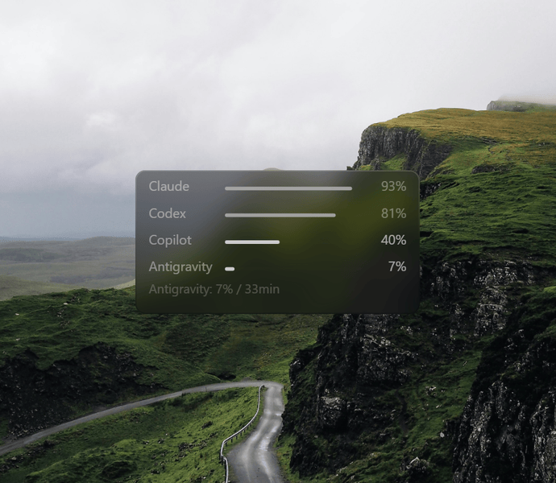
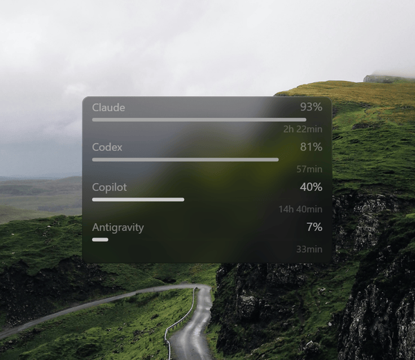

# AI Limits

<p align="center">
<a href="https://napxlexn.github.io/ailimits/"></a>
<a href="https://www.rust-lang.org/"></a>
<a href="https://github.com/napxlexn/ailimits/blob/master/LICENSE"></a>
<a href="https://github.com/napxlexn/ailimits/releases"></a>
<a href="https://github.com/napxlexn/ailimits/actions/workflows/ci.yml"></a>
<a href="https://github.com/napxlexn/ailimits/releases/latest"></a>
<a href="https://github.com/microsoft/winget-pkgs/tree/master/manifests/n/napxlexn/AILimits"></a>
<a href="https://community.chocolatey.org/packages/ailimits"></a>
<a href="https://github.com/napxlexn/scoop-ailimits"></a>
<a href="https://apps.microsoft.com/detail/9P2B0J1VWPWH"></a>
</p>

一款小巧的原生 Windows 11 桌面悬浮窗，直接在桌面上显示各 AI 服务商的用量限额：**Claude**、**OpenAI Codex**、**GitHub Copilot**、**Google Antigravity**、**xAI Grok**、**Cursor**。

<p align="center"><a href="https://napxlexn.github.io/ailimits/"></a></p>

<p align="center" class="languages"><a href="README.md">English</a> · <a href="README.uk.md">Українська</a> · <b>简体中文</b> · <a href="README.ja.md">日本語</a> · <a href="README.es.md">Español</a> · <a href="README.pt-BR.md">Português (Brasil)</a> · <a href="README.de.md">Deutsch</a> · <a href="README.fr.md">Français</a> · <a href="README.pl.md">Polski</a> · <a href="README.it.md">Italiano</a> · <a href="README.nl.md">Nederlands</a> · <a href="README.cs.md">Čeština</a></p>

已上架 [Microsoft Store](https://apps.microsoft.com/detail/9P2B0J1VWPWH)，由 Store 签名并负责更新；也已收录于 [AlternativeTo](https://alternativeto.net/software/ai-limits/about/)——如果它对你有帮助，在那里点个赞，能让更多人发现它。

<p align="center">
<a href="https://apps.microsoft.com/detail/9P2B0J1VWPWH"></a>
</p>

<p align="center">
  
  <br><sub>三个详细级别：Compact、Medium、Expanded。切换即时生效；可选的消耗速率预测（~距达到限额的时间）会在重置时间未知时显示在元信息行中。此处为水平进度条。</sub>
</p>

<p align="center">
  
  <br><sub>隐藏小组件后，用量仍显示在任务栏上。托盘图标以两个圆环显示与任务栏面板相同的两个服务商：小组件中的前两个，或你选定的两个。将指针悬停在面板或托盘图标上，会显示同一份列表：在 Tooltip 列中勾选的行。两者都跟随系统的浅色和深色主题。</sub>
</p>

<table>
<tr>
<td width="50%" align="center" valign="top">
  
  <br><sub>同样的三个级别，使用垂直进度条。</sub>
</td>
<td width="50%" align="center" valign="top">
  
  <br><sub>三档宽度。最窄时不显示服务商名称，由进度条占用其所在的列，因此不会出现重叠。</sub>
</td>
</tr>
<tr>
<td width="50%" align="center" valign="top">
  
  <br><sub>背景不透明度，从近乎透明到近乎不透明。文字和进度条的对比度保持不变。</sub>
</td>
<td width="50%" align="center" valign="top">
  
  <br><sub>卡片大小取决于显示的行数：每个已启用的服务商一行，外加你选择的额外行。</sub>
</td>
</tr>
<tr>
<td width="50%" align="center" valign="top">
  
  <br><sub>单色加八种彩色配色方案，可调整亮度、饱和度和背景不透明度。由应用自身渲染。</sub>
</td>
<td width="50%" align="center" valign="top">
  
  <br><sub>使用垂直进度条时，服务商可以并排排列，也可以堆叠成一列。</sub>
</td>
</tr>
<tr>
<td width="50%" align="center" valign="top">
  
  <br><sub><em>Settings</em>，Providers：勾选的行会立即显示在小组件上；每个服务商的 Sign-in 会说明读取哪些内容以及其令牌发往何处。</sub>
</td>
<td width="50%" align="center" valign="top">
  
  <br><sub><em>Settings</em>，Display：设置每行显示的内容；不显示进度条时，小组件会变小。由应用自身绘制。</sub>
</td>
</tr>
</table>

## 功能

- **只读，绝不写入**。它读取官方 CLI 工具已保存在你电脑上的令牌，从不刷新或轮换这些令牌，因此不会让你从这些工具中登出。唯一的例外是 Cursor：应用使用自己的会话登录 Cursor，从不读取或改动编辑器的登录信息。你自行添加的密钥以及该会话都保存在 Windows 凭据管理器中。应用只连接各服务商自己的端点（对于安装版，还会连接 GitHub 以获取更新），每个周期对每个服务商只发出一次用量请求（另有 [docs/en/PROVIDERS.md](docs/en/PROVIDERS.md#requests-per-cycle)（英文）中列出的少量辅助请求），遵循 Windows 中设置的代理，且不发送任何遥测数据。
- **读取前先征求同意**。在你允许之前，不会读取任何属于其他工具的内容；每次询问都会写明要读取的文件以及其令牌的发送目的地。每项只询问一次，点击一次 *Forget permission* 即可撤销。参见 [What is read, and when](docs/en/CONFIG.md#what-is-read-and-when)（英文）。
- **几乎无需配置**。首次启动时，在这台电脑上找到的工具已预先勾选，并且只用一个问题列出它将读取的每个登录文件：点击 *Allow* 即可。此后，你正常使用 CLI 就能让这些令牌保持有效，无需其他配置。只有 Cursor 需要你在 *Settings* 中登录一次。
- **负载很低，在运行中的应用上实测**。占用单个 CPU 核心的 0.014%，不使用 GPU（在 CPU 上渲染），工作集 53 MB（私有内存 25 MB），以上为 0.7.1 于 2026-11-23 的实测结果；不提高计时器分辨率（2026-11-21）；exe 仅 4 MB。可用 `bench/perf_audit.ps1` 复现；完整数据见 [docs/en/ARCHITECTURE.md](docs/en/ARCHITECTURE.md#resource-footprint-measured-not-estimated)（英文）。
- **过期数据会明确标示为过期**。停止更新的数值会变灰，并显示已过去多久。可证实已重置的限额窗口显示 `≈0%`。应用不会用猜测来填补空缺。你离开电脑时轮询会暂停，这段时间不计入：不会仅仅因为你走开了一会儿就变灰。
- **自包含**。静态链接，因此无需 Visual C++ Redistributable，也不附带任何 DLL。安装程序无需管理员权限。

## 安装

> **从 0.7.0（或 0.6.x）更新，且你的用户配置文件或 TEMP 文件夹路径中包含非英文字符（例如西里尔字母）、`&` 或 `%`？** 旧版本的更新程序在这类路径上会失败：0.7.1 发布后，它可能会在每次启动约半分钟后关闭 AI Limits。请手动安装 0.7.1：从 [Releases](https://github.com/napxlexn/ailimits/releases) 下载 `AiLimits-Setup-0.7.1.exe` 并运行；或者在 winget 提供 0.7.1 之后，运行 `winget upgrade napxlexn.AILimits`。如果小组件在你操作之前就关闭了，请在启动后立即右键单击它，先取消勾选 **Automatic updates**（或在 `%APPDATA%\AiLimits\config.toml` 中设置 `auto_update = false`）。从 0.7.1 起，更新程序会直接启动安装程序，这类路径可以正常使用，你也可以重新勾选 Automatic updates。

在终端中：

```powershell
# winget
winget install napxlexn.AILimits

# one-line install: downloads the latest release, verifies its SHA-256
# against the published digest (the SHA-256 only, not the .sig), runs the
# silent per-user install (no admin rights)
irm https://raw.githubusercontent.com/napxlexn/ailimits/master/install.ps1 | iex

# Scoop, from the project's own bucket
scoop bucket add ailimits https://github.com/napxlexn/scoop-ailimits
scoop install ailimits

# Chocolatey
choco install ailimits

# Microsoft Store (signed and updated by the Store), or https://apps.microsoft.com/detail/9P2B0J1VWPWH
winget install --id 9P2B0J1VWPWH --source msstore
```

也可以从 [Microsoft Store](https://apps.microsoft.com/detail/9P2B0J1VWPWH) 获取：同一个小组件，由 Store 签名并保持更新（新软件包认证期间，可能比正式发布晚几天）。

或者从 [Releases](https://github.com/napxlexn/ailimits/releases) 下载 `AiLimits-Setup-<version>.exe` 并运行。无需管理员权限（安装到 `%LOCALAPPDATA%\AiLimits`）。安装过程中的可选项：随 Windows 自动启动（默认勾选）、创建桌面快捷方式。winget 和 Chocolatey 运行的是同一个安装程序，因此它们安装的副本会像其他安装版一样自行更新，包管理器列出的版本可能比实际运行的版本旧。每个发布版本还附带一个便携版 zip（无安装程序）。便携版不会自行更新：由其包管理器或你自己来更新。设置没有便携模式：每个副本（包括便携版）都将设置保存在 `%APPDATA%\AiLimits` 中。

> 安装程序**未进行代码签名**（Authenticode），因此 Windows SmartScreen 可能会显示“Windows 已保护你的电脑”。请点击 **更多信息 → 仍要运行**。你可以根据每个发布版本公布的 SHA-256 校验下载的文件（见下文）。从 0.7.1 起，每个发布版本还为安装程序和 zip 提供 Ed25519 签名（`.sig`），并且从 0.7.1 起，应用自带的更新程序在没有有效签名时不会安装任何内容。0.7.0 的更新程序会忽略 `.sig`，只检查 GitHub 为安装程序公布的 SHA-256：它更新到 0.7.1 所依赖的正是这个摘要。

如需手动校验下载的文件，请将其 SHA-256 与发布页面上该文件旁显示的 `sha256:` 摘要进行比较；两者必须一致：

```powershell
(Get-FileHash .\AiLimits-Setup-0.7.1.exe -Algorithm SHA256).Hash
```

如还要校验签名，请将 `.sig` 放在该文件旁边，两者都使用发布时的文件名（签名也涵盖文件名）。然后，在本仓库的克隆中切换到对应版本的标签（`git checkout v0.7.1`），运行发布签名工具的 `verify`，它不需要任何密钥（需要 Rust，与 [从源代码构建](#从源代码构建) 中相同）：

```powershell
cargo run --locked --release --manifest-path tools/release-signer/Cargo.toml -- verify $HOME\Downloads\AiLimits-Setup-0.7.1.exe
```

它会输出 `verified`，或者输出 `NOT verified` 及原因。

安装程序不包含任何密钥或令牌。首次启动时，在你允许之前，小组件不会读取下文列出的任何认证来源。

### 卸载

在 Windows 设置的“应用”中卸载，或者使用 `winget uninstall napxlexn.AILimits` 或 `choco uninstall ailimits` 卸载，都会运行安装程序附带的卸载程序。它会关闭 AI Limits，并在不联网的情况下删除：安装文件夹、`%APPDATA%\AiLimits`（设置、缓存、日志）、应用创建的所有凭据管理器条目（密钥、令牌、Cursor 会话）、自动启动项以及通知注册信息。

移除 Scoop 版或便携版时，上述内容都不会被删除：`scoop uninstall ailimits` 或直接删除文件夹，只会移除应用本身的文件。移除之前，请退出 AI Limits，并在其文件夹中运行以下命令（没有可删除内容的命令不会执行任何操作）：

```
ailimits-auth remove claude
ailimits-auth remove copilot
ailimits-auth remove-usage-token claude
ailimits-auth remove-usage-token codex
ailimits-auth logout cursor
```

然后删除 `%APPDATA%\AiLimits` 以及注册表项 `HKCU\Software\Classes\AppUserModelId\napxlexn.AILimits`（应用的 Toast 通知所显示的名称和图标）。对于 Microsoft Store 版：如何事先删除其密钥，见 [docs/en/CONFIG.md](docs/en/CONFIG.md#secrets)（英文）；卸载时会一并删除它自己的设置文件夹（Store 版的文件夹在该文件开头有说明）。

## 快速上手

1. **运行它**。首次启动时会打开一个欢迎窗口（与菜单中的 *Settings…* 是同一个窗口）。其中的问题会列出在这台电脑上找到的工具（Claude Code、Codex CLI、Copilot CLI 或 GitHub CLI、Antigravity、Grok CLI、Cursor），每个工具都带有一个勾选框，并写明它将读取的每个文件以及每个令牌的发送目的地。通过其自身文件夹找到的工具默认勾选；仅找到 GitHub CLI（用于 Copilot）或仅找到 `.gemini`（用于 Antigravity）时，会列出但不勾选。*Allow* 会启用已勾选的工具；*Cancel* 不读取任何内容，之后你可以自行勾选需要的工具，每个工具都会单独询问一次。该窗口不获取键盘焦点（按 Enter 不会意外授予任何权限），并且在全屏应用位于前台时会等待。与 *Settings* 一样，它会一直保持打开，直到按 Esc、点击关闭按钮或按 Alt+F4 将其关闭，并可通过拖动标题来移动。Cursor 需要使用应用自己的登录，只需一次：在同一窗口中，展开 Cursor 下方的 *Sign-in* 行，然后点击 *Sign in to Cursor…*。从 0.7.0 更新无需任何操作：你之前使用的服务商会继续工作，并会有一个窗口列出读取的内容。
2. **放置它**。按住左键拖动。拖动时按住 **Shift**，当它距离显示器工作区（不含任务栏的屏幕区域）最近的边缘 64 px 以内时，会紧贴该边缘。右键菜单中的 `Lock position` 可将其固定。
3. **设置外观**。右键单击可设置详细级别（Compact、Medium、Expanded）、布局（Rows 或 Columns）、配色方案（单色或 8 种颜色）、不透明度、亮度和饱和度。上方的动画展示了每一项。将指针停留在这些菜单项之一上，或停留在 Width、Column layout 或 Usage forecast 上，会在你点击之前就在小组件、面板和托盘图标上预览效果，用键盘移到该项上也是如此；不点击而直接离开菜单则会恢复原样。*Settings…* 用于选择小组件和面板悬停提示中显示的行（包括 Claude 的 Opus 周限额等额外行）、一个显示当前所用模型的可选标签（模型、版本、推理强度），以及每个服务商的登录信息来源。*Model source* 用于选择标签中模型的来源：*Tool settings*，或者 *Last session*，即最新一次 Claude Code 或 Codex CLI 会话所用的模型，从其文件末尾读取（最多读取最后 1 MB）；其他工具显示其设置中的模型。Taskbar 列用于选择面板和托盘图标显示的两个服务商；至少会保持勾选一个。Percentage 和 Time to reset 可分别为面板的悬停提示（Tooltip 列）和面板（Taskbar 列）勾选：显示百分比、距离限额重置的时间，或两者都显示；最后一个保持开启的选项无法取消勾选。Progress bar（默认开启）可以去掉面板中的进度条，以减少对任务栏空间的占用。
4. **将指针悬停在服务商行上**，可以查看其每周限额，替代原本显示的重置倒计时（在 Compact 中显示于底行）。变灰或带 `≈` 的行则会显示原因及解决方法，例如 `token expired — run Claude Code`。在 Medium 和 Expanded 的行中，以及 Compact 的底行中（宽度为 100% 和 75% 时），原因会完整显示；在 Expanded 的列中，原因会截断后显示在列下方；Compact 和 Medium 的列，以及宽度为 50% 的 Compact，不显示原因。
5. **小组件挡住了视线**？右键单击，选择 **Taskbar**，然后选择 *Taskbar panel* 或 *Tray icon*。当小组件被隐藏或被其他窗口遮挡时，用量仍会显示在任务栏上；当全屏应用占据屏幕时，它会随任务栏一起隐藏，并在你离开该应用后重新出现。参见 [任务栏指示器](#任务栏指示器)。
6. **左键单击托盘图标或面板**，可以将小组件调到前台或将其隐藏。右键单击其中任意一个，会打开同一个菜单。
7. **显示的是一条消息而不是数据行**？*Setup required* 或 *No data yet*：单击小组件以打开 *Settings*。*Right-click → set up providers*：已勾选服务商，但没有一个已登录；请在 *Settings* 中检查每个服务商的 *Sign-in*。

## 授权机制

除了 Cursor 需要登录一次之外，小组件从不要求你登录。它通过复用官方 CLI 工具保存在你电脑上的令牌来监控**订阅**限额，严格只读，并且只有在你逐一允许之后才会读取：

| 服务商 | 自动来源（默认） | 启用方法 |
|---|---|---|
| Claude | `%USERPROFILE%\.claude\.credentials.json`（Claude Code 的 OAuth 令牌） | 至少运行一次 [Claude Code](https://claude.com/claude-code) |
| Codex | `%USERPROFILE%\.codex\auth.json`（Codex CLI 令牌；如果设置了 `CODEX_HOME`，则位于其中） | 运行一次 `codex login` |
| Copilot | `gh auth token --hostname github.com`（GitHub CLI） | 运行一次 `gh auth login` |
| Antigravity | Windows 凭据管理器目标 `gemini:antigravity` | 运行 Antigravity CLI，即 `agy`；其令牌有效期约一小时，且只有 `agy` 会续期（打开编辑器不会） |
| Grok | `%USERPROFILE%\.grok\auth.json`（Grok CLI 登录信息；如果设置了 `GROK_HOME`，则位于其中） | 运行 `grok` 并登录一次（需 SuperGrok 订阅） |
| Cursor | 小组件自己的会话，保存在 Windows 凭据管理器中（`cursor_session`）；不会为此读取 Cursor 编辑器的任何内容 | 在 *Settings* 中登录一次 Cursor（Cursor 的 *Sign-in*，*Sign in to Cursor…*），或使用 `ailimits-auth login cursor`：会在浏览器中打开 Cursor 自己的登录页面；会话有效期约 60 天 |

在 *Settings* 的 *Providers* 选项卡中，每个服务商的行下方都有一个 *Sign-in* 行，说明登录信息的来源及其状态（“Claude Code · connected”）。展开它可以选择来源：上表中工具的账户（*Claude Code account* 等），或者对于 Claude、Codex 和 Copilot，使用你自己的密钥或令牌（见下文的“手动授权”）。只会使用所选的来源；它失败时，不会由其他来源替代。

每个工具只询问一次。取消勾选某个服务商的所有行（Widget、Tooltip 和 Taskbar）会暂停它：不再读取或发送它的任何内容，重新勾选后会直接恢复，不再询问。要撤销权限，请展开其 *Sign-in* 并点击 *Forget permission*（当来源为该工具自身的登录信息时显示）：此后不再读取其登录信息，其行会被清除，下次勾选时会重新询问。Cursor 的会话通过 *Sign out* 结束，粘贴的密钥或令牌通过 *Remove* 删除。模型标签的读取在 *Display* 选项卡的 Model、Version 和 Reasoning effort 下方有自己的 *Forget permission*。权限按 Windows 用户分别保存在该用户的 `config.toml` 中。

只有当 Codex CLI 将登录信息保存在文件中时，才会写入 `auth.json`：如果其 `config.toml` 中设置了 `cli_auth_credentials_store = "keyring"` 或 `"auto"`，就不会有 `auth.json`，也就无法读取其登录信息。请将其设为 `"file"`，或者改为粘贴用量令牌。

这些都是 OAuth 访问令牌，除 Cursor 的之外都是短期有效的。每个令牌所属的 CLI 会在你使用它时刷新令牌。小组件从不刷新其他应用的令牌，因为 OAuth 刷新会轮换令牌，导致该 CLI 被登出。Cursor 会话（约 60 天）属于小组件自己：你在浏览器中、在 Cursor 自己的页面上登录 Cursor，小组件会自行保存并刷新该会话。Cursor 没有面向其他应用的登录方式，因此小组件以 Cursor 编辑器客户端的身份登录；它从不读取编辑器的登录信息。`CODEX_HOME`、`GROK_HOME` 和 `COPILOT_HOME` 仅在为绝对路径时才生效。

### 无需任何操作时数据能保持准确多久

| 服务商 | 实时数据的持续时间 | 之后 |
|---|---|---|
| **Claude** | 最后一次 Claude Code 会话后约 8 小时（令牌的实际有效期） | 以灰色显示最后的数值，并显示已过去多久 |
| **Codex** | 在你使用 Codex CLI 期间（其令牌的有效期尚未测得） | 以灰色显示最后的数值，并显示已过去多久 |
| **Copilot** | 无限期。只要你保持登录，gh 就会让其令牌保持有效。 | |
| **Antigravity** | `agy` 最后一次运行后约一小时（只有 `agy` 会续期其令牌） | 以灰色显示最后的数值，并显示已过去多久 |
| **Grok** | 最后一次 Grok CLI 会话后最多约 6 小时（令牌的实际有效期） | 以灰色显示最后的数值，并显示已过去多久 |
| **Cursor** | 登录后约 60 天（会话的有效期） | 以灰色显示最后的数值，并显示 `sign in to Cursor again` |

自 2026 年 6 月 18 日起，Google 已停止为个人用户以及 Google AI Pro 和 Google AI Ultra 用户处理 Gemini CLI 请求。这些用户应迁移到 Antigravity CLI；小组件只读取 Antigravity 保存在 Windows 凭据管理器中的令牌，不再读取旧版 Gemini CLI 的文件。Google 已因有人在 Antigravity 之外使用 Antigravity 的登录信息而暂停了部分账户。小组件每次更新只读取一次你的配额，但风险由你自行承担：请求读取 Antigravity 登录信息的那个问题中也说明了这一点。

**Claude 在服务器端限制了读取频率**。Anthropic 对用量端点进行了速率限制（HTTP 429，`Retry-After: 0`，2026-07-09 验证），且每个令牌的配额与 Claude Code 自身的轮询共享。在 Claude Code 运行期间，即使刷新间隔为 1 分钟，Claude 的一次刷新也可能需要 2 到 3 分钟。下一个周期会按更新间隔再次请求；只有当一个周期内没有任何服务商返回数据时，等待时间才会增加（在 1 分钟间隔下依次为 2 分钟、4 分钟，最多 5 分钟），而速率限制视为没有返回数据。在此期间，将指针悬停在 Claude 行上会显示 `rate-limited, retrying`。其他服务商不受影响。

Claude、Codex、Antigravity、Grok 或 Cursor 的令牌过期不会导致数字出错。最后的数值会保持灰色并显示已过去多久，可证实已重置的窗口显示 `≈0%`，重置倒计时会在本地继续运行。如果你每天都使用这些 CLI，数据几乎始终是实时的。

### 手动授权（不依赖 CLI 或没有 CLI 的环境）

适用于未安装这些 CLI 的环境，或者你希望使用不依赖 CLI 活动的凭据时。各选项实际能提供的内容：

| 服务商 | 手动方式 | 获取途径 | 显示的内容与订阅相同吗？ |
|---|---|---|---|
| **Copilot** | 细粒度个人访问令牌；它不需要任何权限（全部留空即可） | github.com/settings/personal-access-tokens，*Generate new token* | 已于 2026-11-21 实测：不带任何权限的令牌读取到的配额与 GitHub CLI 登录时相同。在你设定的到期时间之前，它都不需要 gh。 |
| **Claude** | API 密钥 | console.anthropic.com，Settings，API Keys，*Create Key*（`sk-ant-…`） | 否。它显示的是你的 API 账户速率限制，而不是 Pro 或 Max 订阅的用量。 |
| **Codex** | 无 | 不存在单独的稳定令牌。粘贴的 *Usage token* 与 Codex CLI 的令牌是同一种 OAuth 令牌。 | |
| **Antigravity** | 无 | 配额与 Antigravity CLI 刷新的 OAuth 令牌绑定，没有单独的密钥能报告相同的数字。 | |
| **Grok** | 无 | SuperGrok 的每周限额只能通过 Grok CLI 自身的登录信息读取。 | |
| **Cursor** | 其自己的登录，约 60 天 | *Settings*，Cursor 的 *Sign-in*，*Sign in to Cursor…*，或 `ailimits-auth login cursor` | 是。显示的就是订阅本身的用量。 |

**添加凭据的两种方式：**

1. **在 *Settings* 中**。复制密钥或令牌。展开该服务商的 *Sign-in* 行，选择来源（Claude：*Usage token* 或 *API key*；Codex：*Usage token*；Copilot：*Fine-grained token*），然后点击 *Paste token from clipboard*（Claude 的 API 密钥则点击 *Paste key from clipboard*）。只接受对应类型的凭据（`sk-ant-...`；`ghp_...`、`github_pat_...`、`gho_...`、`ghu_...` 或经典的 40 位十六进制令牌；ChatGPT 令牌 `eyJ...`）：剪贴板中的其他内容一律拒绝，不会被发送，也绝不会显示或记录到日志中。用量令牌会先通过一次请求进行检查：被拒绝的不会保存。密钥按原样保存，其所在行会显示它是否有效。窗口会告知结果（如果窗口在此期间已关闭，则通过 Toast 通知告知），凭据会直接存入凭据管理器。只会使用所选的来源：选择你的令牌或密钥时，不会读取工具的登录信息；选择工具的账户时，不会发送已保存的令牌。
2. **通过终端**。`ailimits-auth.exe` 与小组件一起位于 `%LOCALAPPDATA%\AiLimits` 中：
   ```
   ailimits-auth status                       # show every detected source
   ailimits-auth set copilot                  # store a PAT (hidden input)
   ailimits-auth set claude                   # store a Claude API key
   ailimits-auth set-usage-token claude|codex # store a manual usage token
   ailimits-auth remove copilot|claude
   ailimits-auth remove-usage-token claude|codex
   ailimits-auth login cursor                 # sign in to Cursor in the browser
   ailimits-auth logout cursor                # forget that session
   ```
   `set-usage-token` 会向服务商的用量端点发送一次请求来检查令牌：被拒绝的（401/403）不会保存；速率限制（429）视为已接受；如果没有得到能说明结果的答复，它会在 2 秒和 4 秒后再次请求，然后保存令牌并附上一条说明。`status` 不做任何更改，并且只在小组件获准读取的情况下才读取其他工具的登录信息。正在运行的小组件会自动应用其他命令所做的更改，无需重启：设置更改会在几秒内生效，新增或删除的密钥或令牌会在下次更新时生效。`set` 和 `set-usage-token` 会将其保存的内容设为该服务商的来源。

**要改回使用工具的登录信息：** 在该服务商的 *Sign-in* 中，选择工具的账户（*Claude Code account*、*Codex CLI account* 或 *GitHub CLI account*）。你的密钥或令牌仍会保存，但不再使用；在选中其来源时点击 *Remove* 即可删除。在终端中，`ailimits-auth remove claude|copilot` 会删除密钥并切换回来；`remove-usage-token` 会删除令牌，但来源仍保持为该令牌，因此该行会隐藏，直到你在窗口中选择工具的账户。

## 右键菜单

右键单击小组件：

- `Settings…`：行、模型标签、模型别名、每个服务商的登录方式。
- **Detail**：Compact / Medium / Expanded。
- **Layout**：Rows / Columns，然后是 Width（100 / 75 / 50%，非 Rows 时变灰）和 Column layout（Side by side / Stacked，非 Columns 时变灰）。
- **Appearance**：Palette（8 种颜色）、Monochrome、Background opacity、Brightness、Saturation。
- **Taskbar**：Tray icon / Taskbar panel / None，以及存在多个任务栏时的 Panel display。
- `Always on top` 和 `Lock position`（两个相互独立的开关），Usage forecast（基于消耗速率的“~距达到限额的时间”，默认关闭）。
- Refresh interval（1 / 5 / 15 / 30 min）和 `Automatic updates`（安装版在后台静默自动更新，默认开启；Store 版、Scoop 版、便携版和自行构建的版本没有此项）。有新版本时只通知一次，通知中带有 *Install now* 和 *What's new*；如果不理会，它会在你下次离开电脑五分钟时自动安装。
- *AI Limits 0.7.1*，带有 GitHub 标志（打开项目页面），以及 Quit。

Usage forecast 的“~时间”只在 Medium 和 Expanded 的行以及 Expanded 的列中显示，且仅在重置时间未知的位置显示，从不针对已停止更新的数据显示。

### 任务栏指示器

当悬浮窗被隐藏或被其他窗口遮挡时，任务栏上仍会保留一个紧凑的用量显示；当全屏应用占据屏幕时，它会随任务栏一起隐藏，并在你离开该应用后重新出现。右键单击 → **Taskbar**：

- **Tray icon**（默认）。一个 16px 图标：两个同心圆环，对应与面板相同的两个服务商（小组件中的前两个，或在 *Settings* 的 Taskbar 列中勾选的两个），用量较高的在外圈，两者都从 12 点钟方向顺时针填充。单色，按系统任务栏主题绘制。
- **Taskbar panel**。时钟旁边的一个透明叠加层。没有窗口或边框，只有绘制在任务栏上、与时钟字号相同的数字和进度条。它为单色，跟随系统的浅色和深色主题，按小组件中的顺序显示前两个服务商，或在 *Settings* 的 Taskbar 列中勾选的两个服务商，显示其百分比（以及进度条，除非在那里取消勾选了 Progress bar）、距离限额重置的时间，或两者都显示（已停止更新的数值或 `≈` 估算值会以较暗的颜色绘制，与小组件将其变灰的方式一致），并在任务栏移动时跟随（自动隐藏、分辨率变化、托盘宽度）。将指针悬停在其上，会显示一个悬停提示，列出在 Tooltip 列中勾选的行（默认包括所有服务商），每行都带有百分比和重置时间。如果“开始”菜单、搜索或自动隐藏的任务栏遮住了它，它会交由托盘圆环接替显示，之后自行恢复。如果全屏应用占据了屏幕，它会随任务栏一起隐藏，并在你按 alt-tab 切出后恢复。它适用于位于屏幕任意边缘的任务栏：在侧边任务栏上，两个服务商会在托盘上方上下堆叠，百分比在上、进度条在下。如果任务栏在最后一个应用按钮与托盘之间没有空余位置，则不显示面板；在有足够空间之前由托盘圆环代替，因此面板绝不会覆盖在按钮上。
- **None**。不显示指示器。

如果 Windows 在多个显示器上显示任务栏，可通过 **Taskbar → Panel display** 选择面板附着在哪个任务栏上。只有存在第二个任务栏时才会出现该子菜单；如果所选显示器之后断开连接，面板会退回到主任务栏。菜单在应用启动时构建，因此之后连接的显示器需要重启应用后才会出现在其中。*Display 2*、*Display 3* 等是按从左到右顺序计数的其他任务栏，而不是 Windows 自己的显示器编号。

左键单击托盘图标或面板会将小组件调到前台（如果它已经位于最前面，则将其隐藏）；右键单击**面板上的任意位置**会打开同一个菜单。

## 配置与诊断

`%APPDATA%\AiLimits\config.toml` 会自动创建，菜单中的每项更改都会保存到其中。在应用运行期间，保存到该文件中的编辑会在约两秒内生效，无需重启；*Settings* 的 *Display* 选项卡末尾的 *Edit config.toml…* 会用记事本打开它。无法读取的行会被忽略并指明，改用其默认值。该文件是自解释的：每项设置前都有一段简短说明，介绍其作用、可取的值以及默认值。格式参考：[docs/en/CONFIG.md](docs/en/CONFIG.md)（英文）。菜单之外的微调（尺寸、颜色、阈值）：[docs/en/TUNING.md](docs/en/TUNING.md)（英文）。

设置 `AILIMITS_LOG=ailimits=debug` 或 `RUST_LOG=ailimits=debug`，即可将诊断日志写入 `%APPDATA%\AiLimits\ailimits.log`（GUI 应用中看不到 stderr）。该文件达到 5 MB 时会轮换：上一个文件保留为 `ailimits.log.1`。

崩溃时会在 `%APPDATA%\AiLimits\crash.log` 中留下一行记录（时间、版本、线程、源代码位置；从不包含崩溃消息的文本）；启动失败时会通过消息框和该文件告知。在 AI Limits 运行时再次启动它，会显示小组件并将其调到前台。

当用量达到服务商的 `alert_threshold`（默认 80%，Copilot 为 85%）时，每个限额窗口会弹出一次阈值 Toast 通知；只有在窗口重置后，或用量降到阈值以下超过 5 个百分点后再次回升时，才会再次通知。配置中的 `[notifications]` 可关闭 Toast 通知（`enabled = false`），并设置同一服务商两次通知之间的最短间隔（`cooldown_minutes`）。

请求遵循 Windows 中设置的代理（设置、网络、代理、“使用代理服务器”）；`HTTPS_PROXY`、`HTTP_PROXY` 和 `ALL_PROXY` 优先，不支持代理脚本（PAC）。`ailimits-auth` 只遵循这些环境变量，不遵循 Windows 设置。使用自有根证书检查 TLS 的网络不受信任：各行会显示“untrusted certificate, retrying”。

## 从源代码构建

需要 Rust 1.90 或更高版本以及 MSVC 工具链：带 C++ 工作负载的 Visual Studio Build Tools 和 Windows SDK，后者的 `rc.exe` 负责嵌入图标、清单和版本信息（见 `build.rs`）。安装程序使用 Inno Setup 6.7.4，由 `release-min` 构建的 exe 生成。从 `target\` 运行的副本不会自行更新，也没有 *Automatic updates* 菜单项。

```
# Rust 1.90+ (MSVC), Windows 11
cargo build --profile release-min --locked   # ~4 MB exe in target/release-min/
cargo test --locked
ISCC.exe installer\ailimits.iss              # the installer, in target/installer/
```

开发者文档：[docs/en/](docs/en/)（英文）。

## 许可证

Copyright (C) 2026 napxlexn.

AI Limits 是自由软件，依据 [GNU 通用公共许可证第 3 版或更高版本](LICENSE) 授权。你可以使用、研究、修改和再分发它。如果你分发修改后的版本，必须依据同一许可证提供其对应的源代码，保留版权和许可声明，并清楚地标明你所做的更改。

本软件的 GPL 许可证并不授予将修改后的构建作为 AI Limits 官方版本发布的权利。有关项目名称和标志的使用规则，请参阅 [TRADEMARKS.md](TRADEMARKS.md)。第三方组件仍受其各自许可证的约束；其声明随每个副本一同提供，见 [THIRD-PARTY-NOTICES.txt](THIRD-PARTY-NOTICES.txt)。
